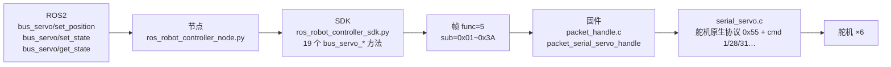

# 01 · 功能域：总线舵机（关节控制）

> `PACKET_FUNC_BUS_SERVO = 5` ｜ SDK 前缀 `bus_servo_*` ｜ **本项目唯一真正在用的域**
> 这份是全套清单的主体：**19 个方法 / 19 个帧子命令 / 3 个 ROS2 接口**

---

## 1. 端到端链条



---

## 2. 接口总表（一行一功能）

| 功能 | ROS2 接口 | 类型 | 节点回调 | SDK 方法 | 帧 `5/sub` | 固件 case | 状态 |
| --- | --- | --- | --- | --- | --- | --- | --- |
| **设位置** | `~/bus_servo/set_position` | sub `ServosPosition` | `set_bus_servo_position` | `bus_servo_set_position` | `0x01` | `0x01` | ☑ 主力 |
| **开/关扭矩** | `~/bus_servo/set_state` | sub `SetBusServoState` | `set_bus_servo_state` | `bus_servo_enable_torque` | `0x0B`/`0x0C` | `0x0B`/`0x0C` | ☑ 已修正 |
| **读状态** | `~/bus_servo/get_state` | srv `GetBusServoState` | `get_bus_servo_state` | 9 个 `bus_servo_read_*` | `0x05`…`0x3A` | 同 | ☑ |
| 停止舵机 | —（无 ROS2 接口） | — | — | `bus_servo_stop` | `0x03` | `0x03` | ⚠️ 未验证 |
| 写 ID | — | — | — | `bus_servo_set_id` | `0x10` | `0x10` | ⚠️ 写 Flash，勿乱用 |
| 设偏差 / 保存 | — | — | — | `bus_servo_set_offset` / `_save_offset` | `0x20` / `0x24` | 同 | ⚠️ 写 Flash |
| 设三类限制 | — | — | — | `bus_servo_set_angle_limit` / `_vin_limit` / `_temp_limit` | `0x30` / `0x34` / `0x38` | 同 | ⚠️ 写 Flash，**本项目不写** |

> 源码行号：节点回调 `ros_robot_controller_node.py` L188(`set_bus_servo_position`) / L165(`set_bus_servo_state`) / L206(`get_bus_servo_state`)；
> SDK `ros_robot_controller_sdk.py` L540(`bus_servo_set_position`) / L497(`bus_servo_enable_torque`) / L595(`bus_servo_read_position`)；
> 固件 `packet_handle.c` L129(`packet_serial_servo_handle`)

---

## 3. `get_state` 服务：可读的 6 类量

请求：`cmd: [ {id: N, get_xxx: 1}, … ]`

| 节点回调里的分支 | 对应 SDK 方法 | 帧 `5/sub` | 返回 | 实测 |
| --- | --- | --- | --- | --- |
| `get_id` | `bus_servo_read_id` | `0x12` | `id` | ✅ |
| **`get_position`** | `bus_servo_read_position` | `0x05` | 位置 0~1000 | ✅ **本项目用** |
| `get_offset` | `bus_servo_read_offset` | `0x22` | 偏差 | — |
| `get_temperature` | `bus_servo_read_temp` | `0x09` | 温度 | — |
| `get_position_limit` | `bus_servo_read_angle_limit` | `0x32` | `[lo,hi]` | ✅ 读出硬限 |
| `get_voltage` | ~~`bus_servo_read_vin`~~ `0x07` | — | — | ❌ **厂商代码里被注释掉** |

`SetBusServoState` / `BusServoState` 里还有：`enable_torque`(`[flag,0/1]`)、`stop`、`save_offset`、`position`、`voltage`、`temperature`、`position_limit`、`present_id`

---

## 4. 帧子命令全表（19 个，权威）

来自固件 `packet_serial_servo_handle()` 的 switch：

| sub | 方向 | 功能 | SDK 方法 | 回包长度 |
| --- | --- | --- | --- | --- |
| `0x01` | 写 | 舵机控制（设位置 + duration） | `bus_servo_set_position` | **不回包** |
| `0x03` | 写 | 停止舵机 | `bus_servo_stop` | 4 |
| `0x05` | 读 | 位置 | `bus_servo_read_position` | 5 |
| `0x07` | 读 | 输入电压 | `bus_servo_read_vin` | 5 |
| `0x09` | 读 | 温度 | `bus_servo_read_temp` | 4 |
| `0x0B` | 写 | **卸载动力（卸力）** | `bus_servo_enable_torque(False)` | 4 |
| `0x0C` | 写 | **加载动力（保持）** | `bus_servo_enable_torque(True)` | 4 |
| `0x0D` | 读 | 动力状态 | `bus_servo_read_torque_state` | 4 |
| `0x10` | 写 | ID 写入 | `bus_servo_set_id` | 4 |
| `0x12` | 读 | ID 读取 | `bus_servo_read_id` | 4 |
| `0x20` | 写 | 位置偏差调整 | `bus_servo_set_offset` | 4 |
| `0x22` | 读 | 位置偏差读取 | `bus_servo_read_offset` | 4 |
| `0x24` | 写 | 偏差保存（Flash） | `bus_servo_save_offset` | 4 |
| `0x30` | 写 | 角度限制设置 | `bus_servo_set_angle_limit` | 4 |
| `0x32` | 读 | 角度限制读取 | `bus_servo_read_angle_limit` | **7** |
| `0x34` | 写 | 电压限制设置 | `bus_servo_set_vin_limit` | 4 |
| `0x36` | 读 | 电压限制读取 | `bus_servo_read_vin_limit` | **7** |
| `0x38` | 写 | 温度限制设置 | `bus_servo_set_temp_limit` | 4 |
| `0x3A` | 读 | 温度限制读取 | `bus_servo_read_temp_limit` | 4 |

---

## 5. `set_position` 报文细节（最常打交道的）

### 5.1 ROS2 消息

```
ServosPosition:
    float32   duration        # 秒
    string    position_unit   # 'pulse' | 'rad' | 'deg'
    ServoPosition[] position  # {uint16 id, float32 position}
```

### 5.2 帧 data 区

```
01 | dur_lo dur_hi | n | (id, pos_lo, pos_hi) × n
```
- `duration` 秒 → **ms**（`int(duration*1000)`），小端
- `pos` 0~1000，小端
- 舵机按 `duration` **自己插值**

### 5.3 现算样例（可直接用于串口终端压测）

| 用途 | 十六进制 |
| --- | --- |
| 写 1 个舵机 `id6→500, 40ms` | `AA 55 05 07 01 28 00 01 06 F4 01 5E` |
| 写 6 个舵机 `全500, 40ms` | `AA 55 05 16 01 28 00 06 01 F4 01 02 F4 01 03 F4 01 04 F4 01 05 F4 01 06 F4 01 62` |
| 读 id6 位置 | `AA 55 05 02 05 06 EC` |
| 卸力 id6 | `AA 55 05 02 0B 06 30` |
| 保持 id6 | `AA 55 05 02 0C 06 5E` |

---

## 6. 关节 ↔ 舵机映射与限位

来自 `servo_controller/config/servo_controller.yaml`（**唯一准**；已对齐舵机硬限 `0x32`）

| 关节 | 舵机 id | 脉冲范围 | 备注 |
| --- | --- | --- | --- |
| joint1 | 6 | 0 ~ 1000 | |
| joint2 | 5 | 125 ~ 875 | 对齐硬限 |
| joint3 | 4 | 1000 ~ 0 | **反向**（min>max） |
| joint4 | 3 | 84 ~ 875 | 软限 −100° ~ +90° |
| joint5 | 2 | 0 ~ 1000 | |
| r_joint | 1 | 0 ~ 700 | 夹爪，init=700 |

换算：`1000 pulse = 240°`（`0.24°/pulse`）

---

## 7. ⚠️ 读路径的硬缺陷（已在本工作区修复）

```python
# 原始厂商代码
data = self.bus_servo_queue.get(block=True)     # 无超时 + 持有 servo_read_lock
```

| 问题 | 后果 |
| --- | --- |
| 读写**共用** `PACKET_FUNC_BUS_SERVO` | 回包都进同一个**单槽**队列（`maxsize=1`） |
| 读前**不清**残留 | 一次残留 → 之后每次读**错位一格**（位置变垃圾） |
| `get(block=True)` **无超时** | 丢一次响应 → **永久阻塞**，且 `servo_read_lock` 不再释放 → 整条读路径死 |

**现象**：`no measured frames` 单调增长且永不恢复（`2s → 7s → 12s`），而下行写入仍正常。

**修复**：`timeout=0.3s` 返回 `None` + 发请求前清空队列 + 按 `id/cmd` 匹配回包。
**实测**：读不存在的 id → **0.10s** 返回 `None`；卡过之后再读正常舵机 **0.01s** 返回。

---

## 8. 性能：读是天花板

| 指标 | 实测 |
| --- | --- |
| 读 1 个舵机 | **≈6 ms** |
| 读 6 个舵机（一轮） | **≈35 ms** → **≈28 Hz 上限** |
| 写 6 个舵机 | 实测 **77 Hz**（462 写/秒）无错 → **6 倍余量** |
| 瓶颈 | **读路径**（同步逐舵机读 + service 往返开销） |

**提速手段（按性价比）**
1. 去掉读的 service 往返：让采样独立成组件，读循环 → 覆盖写状态变量 → 发话题
2. 减少每轮读的舵机数
3. 波特率已 `1000000`，无空间

> ⚠️ 把"写"压到更高频率没有意义（余量已有 6 倍），反而增大电流尖峰 → 触发丢响应，**拉低有效性能**。

---

## 9. 两层协议别混（易错点）

| | 主机 ↔ STM32 | STM32 ↔ 舵机 |
| --- | --- | --- |
| 帧头 | `AA 55` | `55` |
| 读位置 | `sub = 0x05` | `cmd = 28 (POS_READ)` |
| 扭矩 | `0x0B` / `0x0C` | `31/32 (LOAD_OR_UNLOAD)` |
| 位置单位 | 0~1000 | 编码器 tick |

> STM32 负责翻译 —— **改主机侧子命令不需要懂舵机原生协议**。
