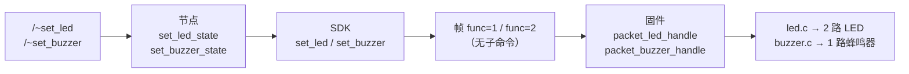

# 02 · 功能域：声光（LED + 蜂鸣器）

> `PACKET_FUNC_LED = 1` ｜ `PACKET_FUNC_BUZZER = 2`
> 两个都**没有子命令字节** —— data 区直接就是参数结构体。

---

## 1. 端到端链条



---

## 2. 接口总表

| 功能 | ROS2 接口 | 类型 | 节点回调 | SDK 方法 | 帧 func | 固件 handler | 状态 |
| --- | --- | --- | --- | --- | --- | --- | --- |
| 板载 LED 闪灯 | `~/set_led` | sub `LedState` | `set_led_state` | `set_led` | **1** | `packet_led_handle` | ☑ |
| 蜂鸣器 | `~/set_buzzer` | sub `BuzzerState` | `set_buzzer_state` | `set_buzzer` | **2** | `packet_buzzer_handle` | ☑ |

源码：节点 `ros_robot_controller_node.py` L100 / L103；SDK `ros_robot_controller_sdk.py` L393 / L398；固件 `packet_handle.c` L101 / L115

---

## 3. LED 细节

**ROS2 消息 `LedState`**
```
uint8   id          # 1 ~ 2（固件里 id-1 后需 < 2，所以只有 1、2 有效）
float32 on_time     # 秒
float32 off_time    # 秒
uint16  repeat      # 次数
```

**SDK**
```python
def set_led(self, on_time, off_time, repeat=1, led_id=1):
    on_time  = int(on_time * 1000)      # 秒 → ms
    off_time = int(off_time * 1000)
    buf_write(PACKET_FUNC_LED, struct.pack("<BHHH", led_id, on_time, off_time, repeat))
```

**帧**
```
AA 55 01 07 <led_id> <on_lo on_hi> <off_lo off_hi> <rep_lo rep_hi> <crc>
```

**固件**
```c
led_id = cmd->led_id - 1;              // 厂商 ID 从 1 开始
if (led_id < 2) led_flash(leds[led_id], on_time, off_time, repeat);
```
→ **只有 2 路 LED**；`id` 传 3 及以上被静默忽略。

---

## 4. 蜂鸣器细节

**ROS2 消息 `BuzzerState`**
```
uint16  freq        # Hz
float32 on_time     # 秒
float32 off_time    # 秒
uint16  repeat
```

**SDK**
```python
def set_buzzer(self, freq, on_time, off_time, repeat=1):
    on_time  = int(on_time * 1000)
    off_time = int(off_time * 1000)
    buf_write(PACKET_FUNC_BUZZER, struct.pack("<HHHH", freq, on_time, off_time, repeat))
```

**帧**
```
AA 55 02 08 <freq×2> <on×2> <off×2> <rep×2> <crc>
```

**固件**
```c
buzzer_didi(buzzers[0], cmd->freq, cmd->on_time, cmd->off_time, cmd->repeat);
```
→ **只有 1 路蜂鸣器**（没有 id 参数）。

---

## 5. 注意

| 项 | 说明 |
| --- | --- |
| **无回包** | LED / 蜂鸣器命令都**不回包**（固件里没有 `packet_transmit`） |
| 时间单位 | SDK 内部把**秒 ×1000 → 毫秒**，结构体字段是 `uint16` → 单次最大 65.5 秒 |
| 上电默认行为 | 固件 `app.c` 开机时会 `buzzer_didi(buzzers[0], 1000, 50, 1, 1)`（短鸣一声） |
| 与机械臂无关 | 本项目（数据采集/回放）**用不到**，仅作背景功能 |
