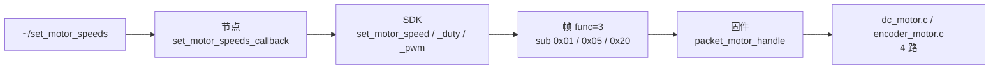

# 03 · 功能域：电机

> `PACKET_FUNC_MOTOR = 3` ｜ SDK 前缀 `set_motor_*`
> ⚠️ **本版固件的电机子命令编号与 SDK 对不上**，见 §4 —— 只有"多路控制"和"直接 PWM"能对上。

---

## 1. 端到端链条



---

## 2. 接口总表

| 功能 | ROS2 接口 | 类型 | 节点回调 | SDK 方法 | 帧 `3/sub` | 状态 |
| --- | --- | --- | --- | --- | --- | --- |
| 设置多路转速 | `~/set_motor_speeds` | sub `MotorsSpeedControl` | `set_motor_speeds_callback` | `set_motor_speed` | `0x01` | ☑ |
| 设置占空比 | —（无 ROS2 接口） | — | — | `set_motor_duty` | `0x05` | ⚠️ 固件无此 case |
| 直接 PWM | —（无 ROS2 接口） | — | — | `set_motor_pwm` | `0x20` | ☑ |

源码：节点 L115 / L106；SDK L403 / L412 / L418；固件 `packet_handle.c` L334

---

## 3. SDK 打包

```python
def set_motor_speed(self, speeds):          # speeds = [[id(1~4), 速度], …]
    data = [0x01, len(speeds)]
    for i in speeds:
        data.extend(struct.pack("<Bf", int(i[0] - 1), float(i[1])))   # id-1, float 速度
    buf_write(PACKET_FUNC_MOTOR, data)

def set_motor_duty(self, dutys):  data = [0x05, len(dutys)] + …     # 结构同上
def set_motor_pwm (self, speeds): data = [0x20,]           + …      # 注意：无 len 字段
```

**ROS2 消息**
```
MotorsSpeedControl:  MotorSpeedControl[] data
MotorSpeedControl:   uint16 id ; float64 speed
```

---

## 4. ⚠️ 固件侧的子命令（`packet_motor_handle`）

```c
switch (frame->data_and_checksum[0]) {
    case 0:    // 单个电机控制
    case 1:    // 多个电机控制      ← SDK 的 set_motor_speed 用 0x01 ✓
    case 2:    // 单个电机停止
    case 3:    // 多个电机停止
    case 0x20: // 直接控制 PWM       ← SDK 的 set_motor_pwm 用 0x20 ✓
}
```

| SDK 方法 | SDK 发的 sub | 固件有对应 case？ |
| --- | --- | --- |
| `set_motor_speed` | `0x01` | ✅ = "多个电机控制" |
| `set_motor_pwm` | `0x20` | ✅ = "直接控制 PWM" |
| `set_motor_duty` | `0x05` | ❌ **没有** |

> 另外 **`case 0/1/2/3` 只用低 8 位**，说明固件把 sub 号当"0~3 的枚举"，
> 而 SDK 用的是 `0x01`/`0x05`/`0x20` —— **两套编号习惯不同**，`0x05` 落在空档上。

---

## 5. 上电时的默认动作

节点 `__init__` 里会先让电机归零：
```python
self.board.set_motor_speed([[1, 0], [2, 0], [3, 0], [4, 0]])
```

> 这是固件初始化的一环（防止上电电机乱转）。

---

## 6. 对本项目的意义

| 项 | 结论 |
| --- | --- |
| 机械臂场景 | **完全用不到**（幻尔机械臂的关节走总线舵机，不走电机） |
| 底盘/传送带 | 若以后接 JetArm 底盘会用到 `set_motor_speed`（已验证可用） |
| 建议 | 保留但标注"机械臂不用"；`set_motor_duty` 标注"固件不支持" |
