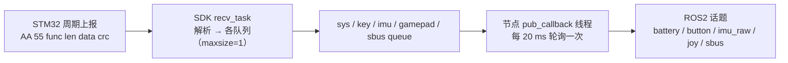

# 04 · 功能域：传感上报

> `PACKET_FUNC_SYS=0` · `KEY=6` · `IMU=7` · `GAMEPAD=8` · `SBUS=9`
> **方向全是 STM32 → 主机**（固件主动推），SDK 侧只有 `get_*`（从队列取，**不发请求**）

---

## 1. 端到端链条



**关键**：这一域**不是**话题或服务触发的 —— 触发源是**串口上来的上报**，节点用**定时器取出**。

---

## 2. 接口总表（一行一路数据）

| 数据 | ROS2 话题 | 类型 | 节点方法 | SDK 方法 | 帧 func | 队列 | 状态 |
| --- | --- | --- | --- | --- | --- | --- | --- |
| **电池电压** | `~/battery` | `std_msgs/UInt16` | `pub_battery_data` | `get_battery` | **0** (SYS) | `sys_queue` | ☑ 实测 7.81 V |
| 按键事件 | `~/button` | `ButtonState` | `pub_button_data` | `get_button` | **6** | `key_queue` | ⚠️ 厂商有 bug |
| IMU | `~/imu_raw` | `sensor_msgs/Imu` | `pub_imu_data` | `get_imu` | **7** | `imu_queue` | ☑ |
| 手柄 | `~/joy` | `sensor_msgs/Joy` | `pub_joy_data` | `get_gamepad` | **8** | `gamepad_queue` | ⚠️ 未见发送点 |
| 航模遥控 | `~/sbus` | `ros_robot_controller_msgs/Sbus` | `pub_sbus_data` | `get_sbus` | **9** | `sbus_queue` | ⚠️ 未见发送点 |

**触发源**：全部由 `pub_callback` 线程 **每 20 ms** 轮询各队列 → 有数据就发话题（**不是事件驱动**）
源码：节点 `ros_robot_controller_node.py` L82(`pub_callback`)；SDK 各 `get_*` 在 L229~L356

---

## 3. 电池电压（唯一实测确认在推的一路）

**帧（逐字节）**
```
AA 55 00 03 04 82 1E 2A
     │  │  │  └──┴─ data: 04 82 1E
     │  │  └─────── len = 3
     │  └────────── func = 0 (SYS)
     └───────────── 帧头（CRC = 0x2A ✓ 已验算）

data[0] = 0x04  → 电池子类型
data[1:]        → uint16 LE = 0x1E82 = 7810 → 7.810 V
```

**SDK**
```python
def get_battery(self):
    data = self.sys_queue.get(block=False)
    if data[0] == 0x04:
        return struct.unpack('<H', data[1:])[0]     # mV
```

**固件结构体**（`Portings/packet_reports.h`）
```c
typedef struct { uint8_t sub_cmd; uint16_t voltage; } PacketReportBatteryVoltageTypeDef;
```

> ⚠️ **源码树里找不到发送点**（只有类型定义）→ 可能在 `JetArmController_v1.0.pkg` 里。
> 实测：**周期性持续发送**。
> 💡 可用作"链路活着"的**心跳信号**。

---

## 4. 各路数据格式

| 话题 | 消息字段 | SDK 解包 |
| --- | --- | --- |
| `~/battery` | `data`(uint16 mV) | `<H` |
| `~/button` | `id`(uint8), `state`(uint8) | `{key_id, event}` |
| `~/imu_raw` | 标准 `sensor_msgs/Imu` | `<6f` = accel[3] + gyro[3] |
| `~/joy` | 标准 `sensor_msgs/Joy` | `<HB4b` = buttons, hat, lx,ly,rx,ry |
| `~/sbus` | `header`(Header), `channel`(float32[]) | `channels[16], ch17, ch18, signal_loss, fail_safe` |

---

## 5. 全部上报结构体（`Portings/packet_reports.h`）

```c
PacketReportBatteryVoltageTypeDef { uint8_t sub_cmd; uint16_t voltage; }          // 实测 0x04
PacketReportKeyEventTypeDef       { uint8_t key_id; uint8_t event; }
PacketReportIMU_Raw_TypeDef       { float accel[3]; float gyro[3]; }
PacketReportIMU_Quat_TypeDef      { float w,x,y,z; }
PacketReportSerialServoTypeDef    { uint8_t servo_id; uint8_t sub_command;
                                    uint8_t success; uint8_t args[8]; }             // 舵机回包
PacketReportPWMServoTypeDef       { uint8_t servo_id; uint8_t sub_command; uint8_t args[8]; }
PacketReportGamepadTypeDef        { uint16_t buttons; uint8_t hat;
                                    int8_t lx,ly,rx,ry; }
PacketReportSBusTypeDef           { int16_t channels[16]; uint8_t ch17,ch18;
                                    uint8_t signal_loss; uint8_t fail_safe; }
```

**源码中的发送点**（`packet_transmit` 全树搜索）

| 位置 | func | 触发 |
| --- | --- | --- |
| `System/app.c:28` | `KEY`(6) | 按键事件 |
| `Portings/imu_porting.c:44` | `IMU`(7) | IMU 采样 |
| **（未找到）** | `SYS`(0) 电池 | — ← 实测存在 |
| **（未找到）** | `GAMEPAD`(8) / `SBUS`(9) | — |

---

## 6. 厂商已知 bug

```python
# 节点 pub_button_data 里
PacketReportKeyEvents(...)      # ← 用了未 import 的名字
```
→ 按键上报路径可能抛 `NameError`。**本项目不使用按键**，未修。

---

## 7. 对本项目的意义

| 项 | 结论 |
| --- | --- |
| 机械臂采集/回放 | 只用得上**电池电压**（当心跳）；其余不用 |
| ⚠️ 接收端注意 | 上报包会**混在舵机回包之间**，必须按 `AA 55 + func + len + CRC` **逐帧跳过**，不能假设收到的都是自己的回包 |
| 队列特性 | 全部 `maxsize=1` + `put_nowait` → **满了就静默丢弃**（只保留最新） |
| 备选用途 | 若做 SmolVLA/多模态采集，`imu_raw` 可直接用 |
