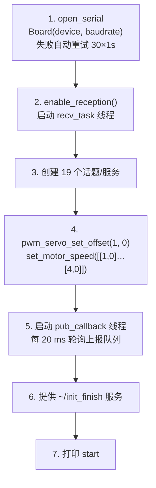

# 05 · 功能域：上电与握手

> 无 `PACKET_FUNC_*`（不发命令帧），属于"节点/串口生命周期"。但**用错了会静默无数据**，必须单列。

---

## 1. 接口总表

| 功能 | ROS2 接口 | 类型 | 节点方法 | 下层动作 | 状态 |
| --- | --- | --- | --- | --- | --- |
| **开关串口接收** | `~/enable_reception` | sub `std_msgs/Bool` | `enable_reception` | `board.enable_reception(flag)` | ☑ |
| **启动完成握手** | `~/init_finish` | srv `std_srvs/Trigger` | `get_node_state` | 恒定返回 `success=True` | ☑ |
| 打开串口 | — | — | `Board.__init__` | `serial.Serial(...)` | ☑ 本工作区加重试 |

源码：节点 `ros_robot_controller_node.py` L95 / L78；SDK `ros_robot_controller_sdk.py` L673 / L136

---

## 2. ⚠️ `enable_reception` —— 最容易被坑的一条

SDK 里 `recv_task` 的读循环：

```python
def recv_task(self):
    while True:
        if self.enable_recv:        # ← 默认 False！
            recv_data = self.port.read()
```

**含义**：
- **默认关闭**（`self.enable_recv = False`）
- 关闭时接收线程**空转不读串口** → 所有 `get_*` 返回 `None`、服务读一直等

**什么时候需要开**：
| 场景 | 需要？ |
| --- | --- |
| 用 ROS2 节点（话题/服务） | ✅ 需要（但节点自身也靠它收 IMU/按键等上报） |
| **`dataset_stream` 走 `get_state` 服务** | ✅ 需要 |
| 直连 SDK 脚本（`My_note/dev/test/read_servo_*.py`） | ✅ **必须先 `board.enable_reception()`** |

> 💡 直连脚本里若忘了这一句，表现是"服务一直不返回 / 读到 None"。
> 注意 SDK 的 `bus_servo_read_and_unpack` 里的 `buf_write` 是**直接写串口**，不受 `enable_recv` 影响 —— 所以**能写不能读**。

---

## 3. 上电流程（节点 `__init__` 顺序）



源码：`Board.__init__` 最后 `time.sleep(0.5)` 后启动 `recv_task`；节点 `__init__` 见 `ros_robot_controller_node.py` L40~L76

---

## 4. `init_finish` 的用途

```python
def get_node_state(self, request, response):
    response.success = True      # 恒定成功
    return response
```

**它不负责任何实际工作** —— 只是一个"节点已起来"的标志位。

本项目用法：`arm_lerobot_dataset_stream` 在启动卸力前先 `wait_for_service('/ros_robot_controller/init_finish')`，
确认驱动真的活着（避免"服务存在但串口已死"的假就绪）。

> ⚠️ 也因此**不能只靠它判断串口可用** —— 它恒真。真正判断要调 `get_state`（`dataset_stream` 已加启动自检）。

---

## 5. 启动排障对照表

| 现象 | 原因 | 处理 |
| --- | --- | --- |
| `SerialException: [Errno 5] could not open port` | CH340 掉线 | 自动重试 30×1s；仍不行→拔插 USB / VMware 重连 |
| 服务存在但读一直返回 `None` | `enable_reception` 没开 | 确认已开（节点默认会开） |
| `driver NOT ready: .../get_state is missing` | 驱动节点已死（多为串口问题） | 看上面一行 |
| 话题都在、就是没数据 | 舵机**电源没开** | 每次读 0.3s 超时后放弃 → 一直没数据但不卡死 |
| 串口打不开且 `/dev/ttyUSB*` 消失 | VMware USB 掉线 | 重新连接设备 |

---

## 6. 对本项目的意义

| 项 | 结论 |
| --- | --- |
| `enable_reception` | **必须开**，否则整条读路径静默失效 → 已写进各测试脚本 |
| `init_finish` | 用作"驱动就绪"握手；**不可当作串口健康检查** |
| 串口打开重试 | 本工作区新增（CH340 在 VMware 下常见 `Errno 5`） |
