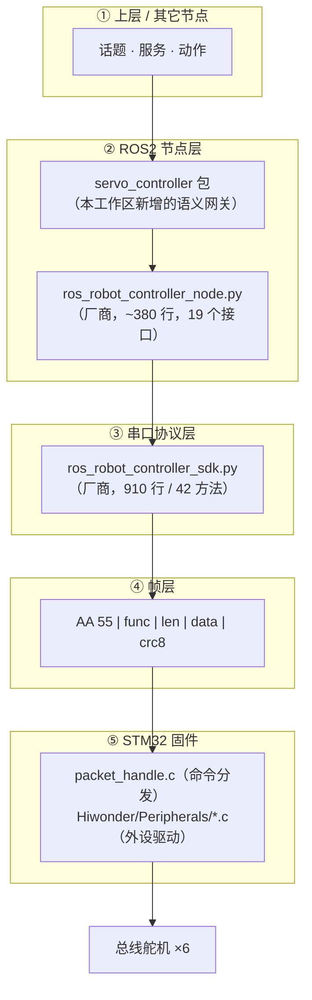

# HuanEr 厂商程序 · 功能清单（按功能域）

> 目的：**一眼看清厂商实现了哪些功能、代码在哪一层**。
> 组织原则：**以功能域为章**（域 ≈ 帧协议的 `PACKET_FUNC_*`，由厂商自己定义，不是我随意切的），
> 域内用**一行一功能**的端到端链条表，把 `ROS2 → 节点 → SDK → 帧 → 固件 → 外设` 一次铺开。

来源工程：`/home/u24/MyTest/dev01/ros2/HuanEr/`
已移植代码：`test_ws01/src/ros_robot_controller*`（本清单以**现有代码**为准，标注移植时的修改）

---

## 1. 端到端架构

**关键**：`功能域 ≈ func 码 ≈ SDK 方法前缀`，三者一一对应。

| 功能域 | `PACKET_FUNC_*` | SDK 方法前缀 | 章 |
| --- | --- | --- | --- |
| **总线舵机（关节）** | `BUS_SERVO = 5` | `bus_servo_*` | [01](01_总线舵机.md) |
| **声光** | `LED = 1` · `BUZZER = 2` | `set_led` · `set_buzzer` | [02](02_声光.md) |
| **电机** | `MOTOR = 3` | `set_motor_*` | [03](03_电机.md) |
| **传感上报** | `SYS=0`·`KEY=6`·`IMU=7`·`GAMEPAD=8`·`SBUS=9` | `get_*` | [04](04_传感上报.md) |
| **上电与握手** | —（无 func） | `enable_reception` | [05](05_上电与握手.md) |
| ❌ **死域**（固件未注册） | `PWM_SERVO=4`·`OLED=10`·`CONVEYOR=12`·`STEPPER=13` | `pwm_servo_*` 等 | [06](06_死域_固件未注册.md) |

---

## 2. 功能域总表（谁被实现了）

| 功能域 | ROS2 接口 | SDK 方法 | 帧 | 固件 handler | 状态 |
| --- | --- | --- | --- | --- | --- |
| 总线舵机 | 2 sub + 1 srv | 19 | `5/0x01`~`0x3A` | `packet_serial_servo_handle` | ☑ **在用** |
| 声光 | 2 sub | 2 | `1` / `2` | `packet_led_handle` / `packet_buzzer_handle` | ☑ |
| 电机 | 1 sub | 3 | `3/0x01`,`0x05`,`0x20` | `packet_motor_handle` | ☑ 机械臂不用 |
| 传感上报 | 5 pub | 5 | `0`,`6`,`7`,`8`,`9` | 各 porting | ☑ |
| 上电与握手 | 1 sub + 1 srv | 1 | — | — | ☑ |
| ~~PWM 舵机~~ | 1 sub + 1 srv | 5 | `4/0x0x` | **未注册** | ✗ |
| ~~OLED / 传送带 / 步进 / RGB~~ | 3 sub + 1 srv | 4 | `10`,`12`,`13` | **无** | ✗ |
| **合计** | **19 个活接口** | **42** | | | |

---

## 3. 节点速览（"这个包/节点有啥"视角的补充）

| 包 | 节点 | 可执行 | 源码 | 启动 |
| --- | --- | --- | --- | --- |
| `ros_robot_controller` | `ros_robot_controller` | `ros_robot_controller` | `ros_robot_controller_node.py` | `ros2 launch ros_robot_controller ros_robot_controller.launch.py` |
| `servo_controller` | `controller_manager` | `servo_controller` | `servo_controller.py` | `ros2 launch servo_controller servo_controller.launch.py` |
| `servo_controller` | `joint_trajectory_action_controller` | — | `joint_trajectory_action_controller.py` | 同上 |
| `arm_lerobot_dataset_stream` | `dataset_stream` | `dataset_stream` | `dataset_stream.py` | `ros2 launch arm_lerobot_dataset_stream arm_lerobot_dataset.launch.py` |

> ⚠️ **接口命名规则**：源码写 `~/xxx` = **私有名** → 实际为 `/节点名/xxx`。
> 例：`~/bus_servo/set_position`（节点 `ros_robot_controller`）→ `/ros_robot_controller/bus_servo/set_position`

---

## 4. 本工作区对厂商代码的改动

| 文件 | 改动 | 原因 |
| --- | --- | --- |
| `ros_robot_controller_sdk.py` | `bus_servo_enable_torque` 的 `0x0B`/`0x0C` **对调** | 厂商写反（实测 `0x0B`=卸力、`0x0C`=保持） |
| 同上 | `get_torque_state` 改调 `bus_servo_read_torque_state` | 原调用了不存在的方法 |
| 同上 | `recv_task`/`buf_write` 加串口异常容错 + 自动重连 | 原会死线程 / 崩节点 |
| 同上 | 打开串口**自动重试 30×1s**；`recv_task` 解析段整体 `try/except` | CH340 `Errno 5` 自愈；接收线程死 = 永久卡死 |
| 同上 | `bus_servo_read_and_unpack` 加 **0.3s 超时** + 发请求前清队列 + 按 `id/cmd` 匹配 | 原 `get(block=True)` 无超时 → 丢一次响应即**永久死锁** |
| `ros_robot_controller_node.py` | 无逻辑改动 | — |

---

## 5. 索引

| 章 | 内容 |
| --- | --- |
| [01 总线舵机](01_总线舵机.md) | 19 个方法与子命令全表、位置/限位、实测耗时与天花板 |
| [02 声光](02_声光.md) | LED、蜂鸣器 |
| [03 电机](03_电机.md) | 转速 / 占空比 / PWM 直控 |
| [04 传感上报](04_传感上报.md) | 电池、IMU、按键、手柄、SBus |
| [05 上电与握手](05_上电与握手.md) | 串口打开、`enable_reception`、`init_finish` |
| [06 死域](06_死域_固件未注册.md) | 有代码但固件不认 → 建议删除或标注 |
| [附录 主机↔STM32 帧协议](附录_主机-STM32帧协议.md) | 帧格式、func 码表、上报结构体、两层协议 |
