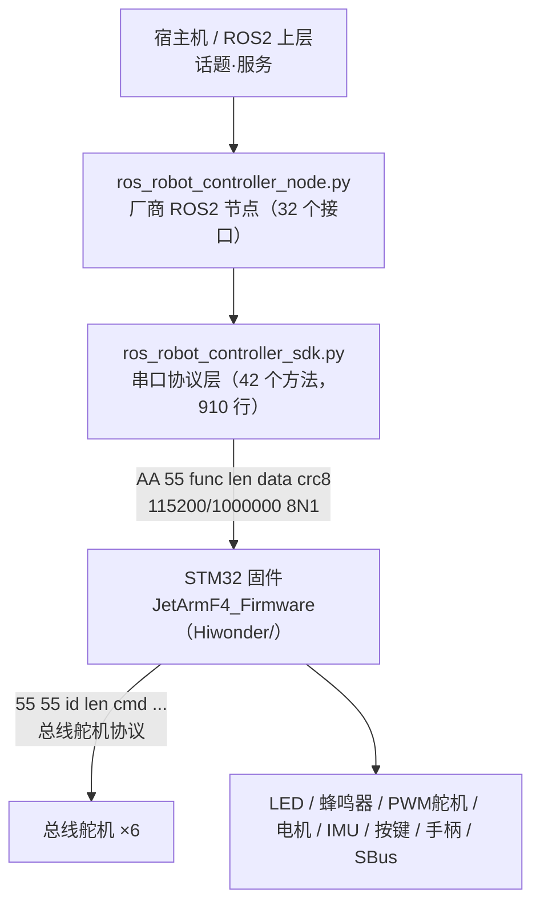

# HuanEr 厂商程序功能清单

> 目的：**摸清厂商实现了什么**，作为"是否重写/重构"的评估输入。
> 来源工程：`/home/u24/MyTest/dev01/ros2/HuanEr/`
> 已移植到本工作区的对应代码：`test_ws01/src/ros_robot_controller*`（本清单以**现有代码**为准，标注移植时的修改）

---

## 0. 厂商程序由 4 层组成

| 层 | 文件 | 规模 | 文档 |
| --- | --- | --- | --- |
| ROS2 节点 | `ros_robot_controller_node.py` | ~380 行 | [03](03_ROS2节点接口清单.md) |
| 串口协议 SDK | `ros_robot_controller_sdk.py` | 910 行 / 42 方法 | [02](02_Python_SDK功能清单.md) |
| 主机↔STM32 帧协议 | — | — | [01](01_主机-STM32协议.md) |
| STM32 固件 | `STM32/JetArmF4_Firmware/Hiwonder/` | — | [04](04_STM32固件功能清单.md) |

---

## 1. 结论速览（评估用）

| 结论 | 依据 |
| --- | --- |
| **总线舵机功能最全**：19 个方法 / 19 个主机子命令（读写位置·ID·偏差·三类限制·扭矩·温度·电压） | [01](01_主机-STM32协议.md) §3 |
| **PWM 舵机在本版固件被禁用**：`packet_pwm_servo_handle` 存在但**未注册** | [04](04_STM32固件功能清单.md) §3 |
| **固件只注册了 4 个 func**：LED / 蜂鸣器 / 总线舵机 / 电机 | 同上 |
| **SDK 比固件"新"**：SDK 有 OLED / 传送带 / 步进电机 / 扩展 func（值到 14），本固件的 `PACKET_FUNC_NONE = 10` → 这些方法在**这块板子上无效** | [01](01_主机-STM32协议.md) §2 |
| **无超时阻塞读**是 SDK 的硬缺陷（已在本工作区修复） | [02](02_Python_SDK功能清单.md) §3 |
| **周期上报**只有 按键 / IMU 在源码里可见；电池电压包实测存在（7.810 V）但**发送点在源码树里找不到** | [01](01_主机-STM32协议.md) §4 |

### 重写 vs 重构（建议）

| 部位 | 建议 |
| --- | --- |
| 帧编解码 / CRC8 / 解析状态机 | **保留**（逻辑正确） |
| 19 个 `bus_servo_*` | **保留**（只是 `func+sub` 组合，重写风险 > 收益） |
| **读路径** | **重构**：抽出"请求→等→按 `id/cmd` 匹配"的统一事务封装 + 超时（本工作区已改） |
| 未被固件注册的功能（PWM/OLED/传送带/步进） | **删除或标注不可用**，减少误导 |
| 真正的性能上限 | 在**读**：6 舵机一轮 35ms ≈ **28 Hz 天花板**；写有 6 倍余量 |

---

## 2. 本工作区对厂商代码做过的改动（与原始工程差异）

| 文件 | 改动 | 原因 |
| --- | --- | --- |
| `ros_robot_controller_sdk.py` | `bus_servo_enable_torque` 的 `0x0B`/`0x0C` **对调** | 厂商写反（实测 `0x0B`=卸力、`0x0C`=保持） |
| 同上 | `get_torque_state` 改调 `bus_servo_read_torque_state` | 原调用了不存在的 `bus_servo_read_torque` |
| 同上 | `recv_task`/`buf_write` 加串口异常容错 + 自动重连 | 原会死线程 / 崩节点 |
| 同上 | 打开串口**自动重试 30×1s**；`recv_task` 解析段整体 `try/except` | CH340 的 `Errno 5` 自愈；接收线程死 = 永久卡死 |
| 同上 | `bus_servo_read_and_unpack` 加 **0.3s 超时** + 发请求前清队列 + 按 `id/cmd` 匹配回包 | 原 `get(block=True)` 无超时 → 丢一次响应即**永久死锁** |
| `ros_robot_controller_node.py` | 无逻辑改动 | — |

---

## 3. 索引

| 文档 | 内容 |
| --- | --- |
| [`01_主机-STM32协议.md`](01_主机-STM32协议.md) | 帧格式、func 码表、总线舵机子命令全表、上报包类型 |
| [`02_Python_SDK功能清单.md`](02_Python_SDK功能清单.md) | 42 个方法逐个列出（参数 / 子命令 / 用途 / 验证状态） |
| [`03_ROS2节点接口清单.md`](03_ROS2节点接口清单.md) | 话题 / 服务 / 消息 / 参数 |
| [`04_STM32固件功能清单.md`](04_STM32固件功能清单.md) | 外设驱动、已注册/未注册的命令、周期上报 |
