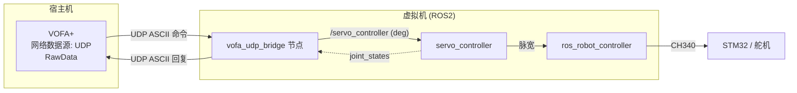

# 上位机 VOFA+ UDP 控制方案

> 回链：[`pi_project_mem.md`](pi_project_mem.md) ｜ 关联：[`宿主机串口控制方案.md`](宿主机串口控制方案.md)、[`arm_control_ros2_design.md`](arm_control_ros2_design.md)
> 状态：**✅ 已实现、UDP 联调通过**

---

## 1. 目标

- 把「宿主机 ↔ 机械臂」的**串口链路**换成 **UDP**，上位机用 **VOFA+（RawData / ASCII 字节流）** 收发。
- **双向**：VOFA+ 能发命令控制机械臂，也能收到 `OK/ERR/STATE` 回复（功能与串口桥一致，**最小迁移**）。
- IP / 端口用 **JSON 文件**配置；走**仅主机（host-only）**网络。

---

## 2. 拓扑



---

## 3. 网络（仅主机）

| 侧 | 地址 | 说明 |
| --- | --- | --- |
| 虚拟机 | `192.168.174.128` | `ens37`（仅主机） |
| 宿主机 | `192.168.174.1` | VMware **VMnet1** |
| 端口 | `1347`（可改） | VOFA+ 与节点的 UDP 端口 |

> `ens33 = 192.168.106.x` 是 NAT，本方案**不用**。

---

## 4. 配置（JSON）

`config/vofa_udp.json`（安装后位于 `share/arm_vofaUDP_bridge/config/`）：

```json
{
  "local_ip": "0.0.0.0",
  "local_port": 1347,
  "remote_ip": "192.168.174.1",
  "remote_port": 1347
}
```

- `local_ip`：节点绑定地址（`0.0.0.0` = 所有网卡；只想仅主机就填 `192.168.174.128`）。
- `remote_ip`：VOFA+ 所在宿主机地址（仅主机 = `192.168.174.1`）。
- 用 `config_file:=/path/xxx.json` 可指定自定义文件。

---

## 5. 协议（VOFA RawData，ASCII，`\n`/`\r` 结尾）

| 命令 | 含义 | 示例 |
| --- | --- | --- |
| `PING` | 心跳 | `PING` → `PONG` |
| `Q` | 查询**缓存**关节角（指令值） | `Q` → `STATE J1=.. J2=..` |
| `R` | 读取**实测**关节角 | `R` → `MEAS J1=.. J2=..` (deg) |
| `H` | 回初始 | `H` → `OK H` |
| `A <j> <deg> [T ms]` | 设角度（可多关节） | `A J5 23.3` → `OK A J5 23.3` |
| `L` | **卸力**（关闭扭矩，可手动拖动） | `L` → `OK L` |
| `E` | **保持**（开启扭矩） | `E` → `OK E` |

> **`Q` vs `R`**：`Q` 来自 `/controller_manager/joint_states`，是**最近下发的指令值缓存**（手动拖动不会变）；`R` 走驱动节点的 `get_state` 服务读**真实舵机位置**（`0x05`），卸力后仍可读。
> `L`/`E` 直接下发 `SetBusServoState`（`enable_torque`）到 `/ros_robot_controller/bus_servo/set_state`，对 6 个舵机全部生效。
> 采集数据（lerobot / SmolVLA）时：`L` 卸力 → 手动拖动 → 用 `R`（或后续可加的实测话题）读数。

- 关节名 `J1`…`J5` + `G`（夹爪），单位 `deg`；解析/换算逻辑与串口桥**完全共用**（`arm_serial_bridge.protocol`）。
- **RawData 无分隔符兼容**：VOFA+ RawData 不保证带 `\n`，多条命令可能粘连（如 `A J1 5.9A J1 -12.1H`）；节点用 `split_commands()` 在命令关键字处自动切分。
- 越界由网关 `pos_rad_to_pulse()` clamp。

---

## 6. 组件

| 文件 | 职责 |
| --- | --- |
| `arm_vofaUDP_bridge/config.py` | 读 JSON 配置（纯函数，可单测） |
| `arm_vofaUDP_bridge/servo_map.py` | 关节映射 + `pulse→deg` 换算（读 `servo_controller.yaml`，纯函数，可单测） |
| `arm_vofaUDP_bridge/vofa_udp_bridge.py` | ROS 节点：UDP 收发 ↔ `/servo_controller`、`get_state`/`set_state` |
| `launch/arm_vofa_control.launch.py` | 驱动 + 网关 + UDP 桥 一条命令起 |
| `test/test_config.py`、`test/test_servo_map.py` | 单测 |

**节点参数**：`config_file`、`default_duration`、`state_rate_hz`（>0 时定时把 `STATE` 推给 `remote_ip`）、`servo_config`（关节映射用，默认取 `servo_controller` 的 yaml）。
**依赖**：`arm_serial_bridge`（复用 `protocol`）、`ros_robot_controller_msgs`（读写舵机状态）。

---

## 7. 启动

```bash
ros2 launch arm_vofaUDP_bridge arm_vofa_control.launch.py
# 覆盖配置 / 关掉周期推送
ros2 launch arm_vofaUDP_bridge arm_vofa_control.launch.py \
  config_file:=/path/my.json state_rate_hz:=10.0
```

VOFA+ 侧：新增数据源 → **网络 / UDP** → 本地端口 `1347` → 协议选 **RawData**；发送区发 `A J5 23.3`。

---

## 8. 验证结果

- `colcon test`（`arm_serial_bridge` + `arm_vofaUDP_bridge`）：**39 tests, 0 failures**。
- UDP 端到端（模拟 VOFA 客户端）：`PING→PONG`、`A J5 23.3→OK` 且 `/servo_controller` 收到 `('deg',[(2,23.3)])`、`A J9 1→ERR unknown_joint J9`；配置文件端口生效。
- **R/L/E 集成测试**（假驱动提供 `get_state` + 记录 `set_state`）：
  - `R` → `MEAS J1=120.0 J2=120.0 J3=-120.0 J4=120.0 J5=120.0 G=72.0`（实测脉冲 1000；joint3 反向、r_joint init=700）
  - `L` → `OK L` 且 6 个 `enable_torque=[1,0]`；`E` → `OK E` 且 `enable_torque=[1,1]`
  - `A J5 23.3` 仍正常

---

## 9. 与串口方案对比

| | 串口桥 `arm_serial_bridge` | UDP 桥 `arm_vofaUDP_bridge` |
| --- | --- | --- |
| 传输 | 串口 `/dev/ttyUSB1` | UDP + JSON 配置 |
| 上位机 | 串口终端 / `host_arm.py` | **VOFA+（RawData）** |
| 协议/功能 | `PXNG/Q/H/A` | **完全相同**（共用 `protocol`） |

---

## 10. 关联文档

- 串口方案：[`宿主机串口控制方案.md`](宿主机串口控制方案.md)
- 架构/组件：[`arm_control_ros2_design.md`](arm_control_ros2_design.md)、[`arm_control_components.md`](arm_control_components.md)
- 枢纽：[`pi_project_mem.md`](pi_project_mem.md)
