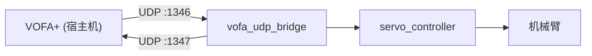

# 07 UDP 桥（VOFA+）

> 目标：上位机 VOFA+ 用 **UDP RawData** 双向控制，不用串口。
> 对应代码：`src/arm_vofaUDP_bridge/`

---

## 拓扑



## 网络配置（`config/vofa_udp.json`）

```json
{
  "local_ip": "0.0.0.0",
  "local_port": 1347,
  "remote_ip": "192.168.174.1",
  "remote_port": 1346
}
```
- VM = `192.168.174.128`，宿主机（VMnet1）= `192.168.174.1`，走**仅主机网**。

---

## 步骤

### 1. 启动

```bash
cd /home/u24/MyTest/dev01/ros2/test_ws01
source /opt/ros/jazzy/setup.bash && source install/setup.bash
ros2 launch arm_vofaUDP_bridge arm_vofa_control.launch.py
```

### 2. VOFA+ 配置

- 选 **RawData**。
- 发送目标：`192.168.174.128:1347`。
- 本机接收端口：`1346`。
- 发送框里输入命令（同第 06 章）：`R`、`A joint1 30 500`、`L`、`E`。

### 3. 命令行模拟 VOFA

```bash
python3 -c "
import socket
s = socket.socket(socket.AF_INET, socket.SOCK_DGRAM)
s.sendto(b'R\n', ('192.168.174.128', 1347))
s.settimeout(2)
print(s.recv(200))
"
```
预期：收到角度回包。

---

## 原理（极简）

- **复用** `arm_serial_bridge.protocol`（同一套命令解析，DRY）。
- UDP 无连接、**不保证到达** → 适合小命令，可重发。
- `split_commands()` 处理 VOFA 把多条命令粘成一包。

## 常见坑

- 两个端口写反（谁监听、谁发送要对上）。
- 网段不对：必须走**仅主机网**（VMnet1），不要用 NAT。
- 命令末尾要带换行 `\n`。
- VOFA 的发送格式选 **RawData**，不要用普通文本模式（会加字段头）。
