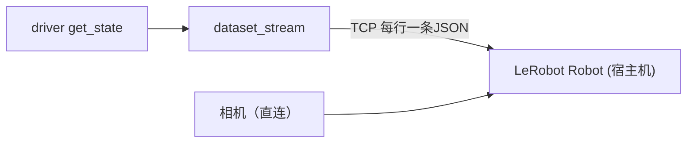

# 08 LeRobot 数据流

> 目标：VM 把**实测关节角**用 TCP+JSON 推给宿主机 LeRobot（宿主机不用装 ROS2）。
> 对应代码：`src/arm_lerobot_dataset_stream/`
> 完整协议见：[`../lerobot数据集流协议.md`](../lerobot数据集流协议.md)

---

## 拓扑



## 帧格式

```json
{"t":1789..., "seq":42,
 "names":["joint1","joint2","joint3","joint4","joint5","r_joint"],
 "q":[0.13,0.33,-1.25,-0.59,-0.11,-0.53],
 "pulse":[533,581,800,358,472,572]}
```

---

## 步骤

### 1. 启动

```bash
cd /home/u24/MyTest/dev01/ros2/test_ws01
source /opt/ros/jazzy/setup.bash && source install/setup.bash
ros2 launch arm_lerobot_dataset_stream arm_lerobot_dataset.launch.py \
  tcp_port:=1348 poll_rate_hz:=30.0 release_torque:=true
```

| 参数 | 默认 | 说明 |
| --- | --- | --- |
| `tcp_port` | 1348 | 监听端口 |
| `poll_rate_hz` | 30.0 | 采样率 |
| `release_torque` | false | 启动即卸力（方便手拖） |

### 2. 自测（VM 本机）

```bash
python3 -c "import socket;s=socket.create_connection(('127.0.0.1',1348),timeout=3);print(s.recv(4096).decode());s.close()"
```
预期：打印一行 JSON。

### 3. 宿主机接收

```python
import socket, json
s = socket.create_connection(('192.168.174.128', 1348), timeout=3)
buf = b''
while True:
    buf += s.recv(4096)
    while b'\n' in buf:
        line, buf = buf.split(b'\n', 1)
        if line:
            f = json.loads(line)
            print(dict(zip(f['names'], f['q'])))
```

---

## 原理（极简）

- 定时轮询 `get_state` 读 6 个舵机 → 换算弧度 → 一行 JSON 广播给所有客户端。
- **只有有客户端连接时才轮询**（省串口带宽）。
- 线程：TCP accept 线程 + 采样定时器；客户端列表加锁。

## 常见坑

- **`_clients` 是 rclpy `Node` 的内部属性**（`create_client` 会往里塞），自定义别用这个名字。
- TCP 会**粘包/半包**：必须按 `\n` 切分再 `json.loads`。
- `release_torque` 要**等驱动 `init_finish` 就绪**再发，否则消息丢失。
- 舵机电源没开 → `get_state` 卡住 → 一帧都发不出。
- VM 若开了 `ufw`，放行端口：`sudo ufw allow 1348/tcp`。
