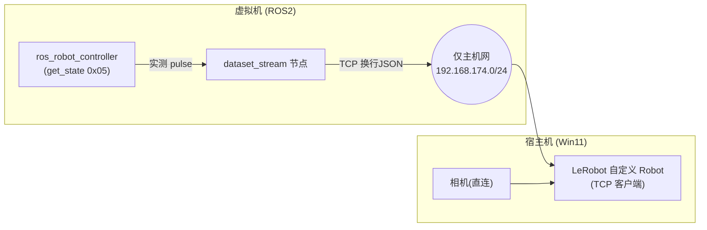

# LeRobot 数据集流协议（arm_lerobot_dataset_stream）

> 回链：[`pi_project_mem.md`](pi_project_mem.md) ｜ 关联：[`VOFA_UDP控制方案.md`](VOFA_UDP控制方案.md)、[`代码组织结构.md`](代码组织结构.md)
> 状态：**✅ 已实现、集成测试通过**
> 用途：VM(ROS2) 把**实测关节角**通过 TCP+JSON 流给宿主机上的 LeRobot 自定义 Robot 类，**宿主机无需装 ROS2**。

---

## 1. 拓扑



- 视频**不经网络**（相机直连宿主机）。
- **VM 是 TCP 服务端**，宿主机是客户端。

---

## 2. 用法

### 2.1 前置

- 机械臂已接（默认 `/dev/ttyUSB0`）；VM 与宿主机在仅主机网段（VM `192.168.174.128`）。
- 已编译并 source 环境：
  ```bash
  cd /home/u24/MyTest/dev01/ros2/test_ws01
  source /opt/ros/jazzy/setup.bash && source install/setup.bash
  ```

### 2.2 启动（VM 侧）

```bash
ros2 launch arm_lerobot_dataset_stream arm_lerobot_dataset.launch.py
# 常用覆盖
ros2 launch arm_lerobot_dataset_stream arm_lerobot_dataset.launch.py \
  tcp_port:=1348 poll_rate_hz:=30.0 release_torque:=true
```

| 参数 | 默认 | 说明 |
| --- | --- | --- |
| `arm_device` | `/dev/ttyUSB0` | 机械臂串口 |
| `arm_baudrate` | `1000000` | 串口波特率 |
| `tcp_port` | `1348` | 监听端口（可配） |
| `poll_rate_hz` | `30.0` | 采样率（Hz） |
| `release_torque` | `false` | 启动即卸力，方便手拖录制 |

> 监听地址 `tcp_host` 默认 `0.0.0.0`（所有网卡）；只想仅主机网可在节点参数里设为 `192.168.174.128`。

### 2.3 启动成功的样子

```
[dataset_stream]: dataset_stream TCP 0.0.0.0:1348 @ 30.0 Hz, joints=['joint1', ..., 'r_joint']
[dataset_stream]: client connected: 192.168.174.1:xxxxx     # 有客户端接入时
```

### 2.4 自测（可选）

VM 本机验证端口与数据：
```bash
python3 -c "import socket;s=socket.create_connection(('127.0.0.1',1348));print(s.recv(4096).decode())"
```

若启用了 `ufw`，放行端口：
```bash
sudo ufw allow 1348/tcp
```

### 2.5 录制流程（手工引导采集）

1. 启动带 `release_torque:=true`（或之后再发 `L`）→ 机械臂**变软**；
2. 宿主机侧连上 TCP，开始接收 `q`；
3. 手动拖动机械臂，LeRobot 录制（相机在宿主机，不经网络）；
4. 录完发 `E`（或直接发 `A`）重新保持。

> `L`/`E`/`A`/`R` 走 [`VOFA_UDP控制方案.md`](VOFA_UDP控制方案.md) 的 UDP 桥；**本数据集节点只做上行数据流**。

### 2.6 连接信息

| 项 | 值 |
| --- | --- |
| 方向 | 宿主机 → `connect()` → VM |
| 地址 | `192.168.174.128:1348`（端口可配） |
| 协议 | 纯 TCP，UTF-8 文本，每行一个 JSON（`\n`） |
| 推送 | **仅在有客户端连接时**推送（省串口带宽） |
| 多客户端 | 支持（广播给所有连接） |

---

## 3. 帧格式

一行一个 JSON（紧凑，无空格）：

```json
{"t":1789287268.1234,"seq":42,"names":["joint1","joint2","joint3","joint4","joint5","r_joint"],"q":[0.21,-0.13,0.0,0.0,0.28,0.0],"pulse":[566,500,500,500,520,700]}
```

| 字段 | 类型 | 说明 |
| --- | --- | --- |
| `t` | float | 墙钟时间（秒，`time.time()`），用于对齐/打时间戳 |
| `seq` | int | 自增序号（从 1），用于检测丢帧 |
| `names` | str[] | 关节名，**顺序权威**（以它为准，不要假设固定下标） |
| `q` | float[] | **弧度**，与 `names` 一一对应 |
| `pulse` | int[] | 原始舵机值 `0..1000`（`500`≈中位） |

- 默认顺序：`joint1, joint2, joint3, joint4, joint5, r_joint`（`r_joint` 是夹爪）。
- 角度换算：`deg = degrees(q)`；`q` 已经按各关节 `init/flip` 处理过，可直接用。
- 若某次某舵机读不到，该帧会**少对应通道**（`names`/`q`/`pulse` 同步缺）——用 `names` 对齐。

---

## 4. 宿主机侧示例（Python，仅标准库）

```python
import json
import socket
import threading
import time


class ArmStreamClient:
    """Read arm joint states from the VM dataset_stream over TCP."""

    def __init__(self, host='192.168.174.128', port=1348):
        self.host = host
        self.port = port
        self.latest = None          # 最新一帧 dict
        self._sock = None
        self._stop = False

    def start(self):
        self._thread = threading.Thread(target=self._run, daemon=True)
        self._thread.start()

    def _run(self):
        while not self._stop:
            try:
                self._sock = socket.create_connection(
                    (self.host, self.port), timeout=3.0)
                self._sock.settimeout(1.0)
                buf = b''
                while not self._stop:
                    try:
                        chunk = self._sock.recv(4096)
                    except socket.timeout:
                        continue
                    if not chunk:
                        break
                    buf += chunk
                    while b'\n' in buf:
                        line, buf = buf.split(b'\n', 1)
                        if line:
                            self.latest = json.loads(line)
            except OSError:
                time.sleep(1.0)     # 掉线后 1s 重连
            finally:
                if self._sock:
                    self._sock.close()

    def get_observation(self):
        """Return {joint_name: rad} of the newest frame (or None)."""
        frame = self.latest
        if frame is None:
            return None
        return dict(zip(frame['names'], frame['q']))


if __name__ == '__main__':
    client = ArmStreamClient()
    client.start()
    for _ in range(5):
        time.sleep(0.5)
        print(client.get_observation())
```

**接 LeRobot**：在自定义 `Robot.get_observation()` 里返回该 dict（或展平成固定顺序的数组），
动作 `send_action()` 若要回放/推理，再另加一条下行通道（当前版本**只上行**）。

---

## 5. 注意事项

- **按行读取**：TCP 会粘包/半包，务必攒到 `\n` 再 `json.loads`（上面示例已处理）。
- **重连**：VM 侧客户端断开不影响节点；宿主机重连即可继续。
- **丢帧检测**：用 `seq` 判断（正常 +1）。
- **首帧延迟**：节点只在**有客户端连接后**才开始采样，连接后约 1 个采样周期出第一帧。
- **关节顺序**：以 `names` 为准；默认 `joint1..joint5, r_joint`。
- **扭矩**：`release_torque:=true` 启动即卸力；否则按需用 VOFA/UDP 桥发 `L`。
- **串口掉线**：不影响本节点存活；驱动会自动重连（见 [`arm_control_port_plan.md`](arm_control_port_plan.md)）。
- **舵机电源必须开**：舵机总线没电时，驱动的 `get_state` 会**永久阻塞**（SDK 读舵机无超时），导致本节点发不出帧。此时先确认舵机电源/总线。

---

## 6. 关联文档

- 组件/架构：[`代码组织结构.md`](代码组织结构.md)
- 串口/UDP 控制：[`宿主机串口控制方案.md`](宿主机串口控制方案.md)、[`VOFA_UDP控制方案.md`](VOFA_UDP控制方案.md)
- 枢纽：[`pi_project_mem.md`](pi_project_mem.md)
