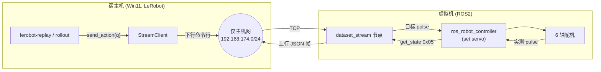
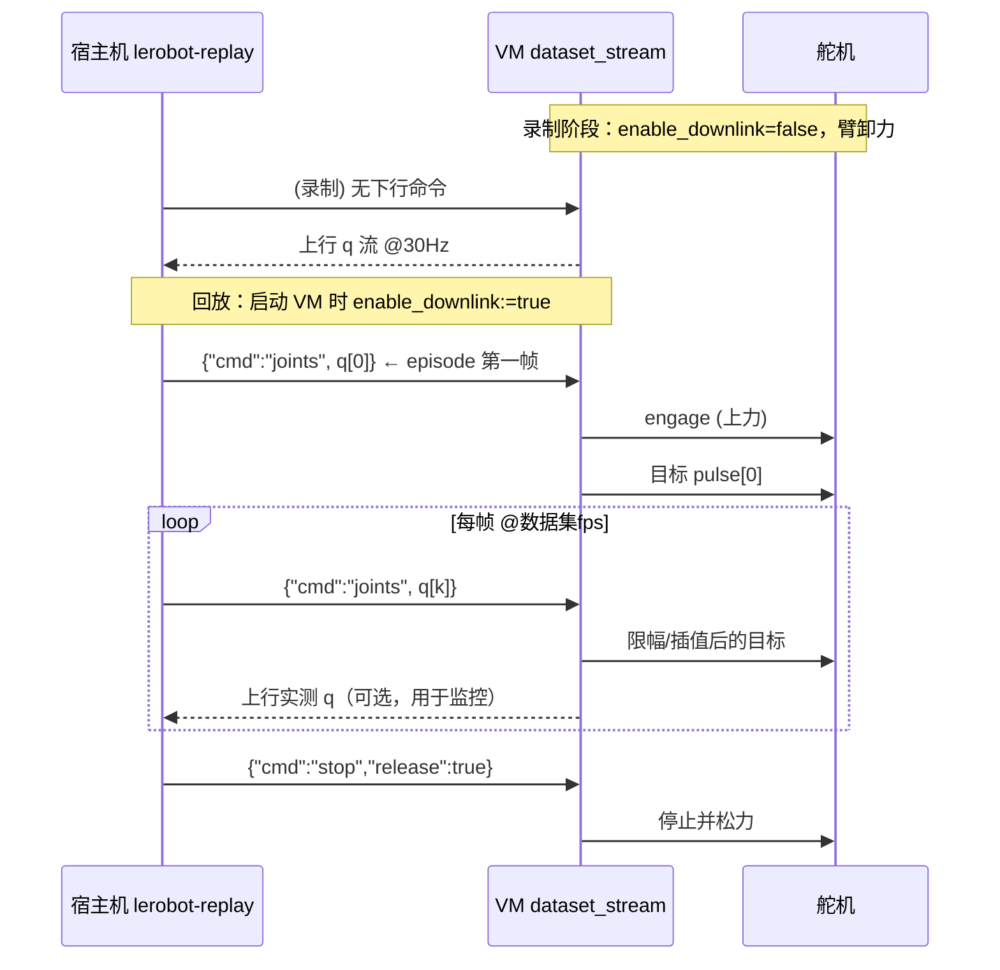

# LeRobot 下行控制协议与 VM 侧设计目标

> 回链：[`lerobot数据集流协议.md`](lerobot数据集流协议.md) ｜ 关联：[`VOFA_UDP控制方案.md`](VOFA_UDP控制方案.md)、[`代码组织结构.md`](代码组织结构.md)
> 状态：**✅ VM 侧已实现**（`dataset_stream` 节点，2026-09-14）
> 版本：`proto` 1 ｜ 面向对象：VM(ROS2) 侧开发者
> 用途：让宿主机上的 LeRobot 能把**动作命令**下发回机械臂，从而支持 **`lerobot-replay` 回放**（以及后续的 `lerobot-rollout` 策略推理）。

---

## 0. 一句话

现有的 `dataset_stream` 节点**只上行**（VM → 宿主机）。
本设计在**同一条 TCP 连接**上增加**下行**（宿主机 → VM），并给出**失效安全**的开关、看门狗和扭矩状态机，
使「录制时绝不驱动、回放时才驱动」成为硬保证。

---

## 1. 背景

### 1.1 现状

```
VM(ROS2)  ──TCP 仅上行 JSON──▶  宿主机 Windows(LeRobot)
```

- 采集方式：**单臂手拖示教**。录制时机械臂必须保持**卸力（软）**，靠人手拖动。
- 宿主机 `Armpi.send_action()` 每帧都会被 LeRobot 调用（`record_loop` 第 358 行），
  但目前默认 `enable_commands=False`，**不写硬件**。

### 1.2 需求

1. 能用 `lerobot-replay` 把录好的数据集动作**逐帧回放到真实机械臂**。
2. **录制流程完全不受影响**：录制时机械臂绝不能上力、绝不能发命令。
3. 回放/推理时命令能可靠、实时地到达舵机。
4. 任何异常（进程崩溃、网线拔出、VM 重启）都要**自动回到安全状态**（停止 + 松力）。

---

## 2. 设计目标

### 2.1 必须满足（P0）

| # | 目标 | 说明 |
|---|---|---|
| G1 | **录制零干扰** | 录制链路（`enable_commands=false` + VM `enable_downlink=false`）下，VM **不得**执行任何下行命令，机械臂保持卸力可拖 |
| G2 | **仅显式开启才驱动** | VM 侧 `enable_downlink` 默认 `false`；开启时打明显日志 |
| G3 | **失效安全** | 看门狗超时 / 客户端断连 / 解析失败累计 → 停止下发并按配置松力 |
| G4 | **复用现有连接** | 不新增端口、不新增宿主机网络配置；同一条 TCP 双向 |
| G5 | **单位一致** | 下行使用与数据集 `action` 相同的**弧度**与**关节顺序**，避免二次换算误差 |
| G6 | **绝对角度** | 命令是**目标绝对关节角**，不是增量 |

### 2.2 尽量满足（P1）

| # | 目标 | 说明 |
|---|---|---|
| G7 | 可观测 | 每条命令/状态变化有日志，可统计命令速率与延迟 |
| G8 | 可限幅 | 支持 `max_step`（单周期最大变化）与速度钳制，防止数据跳变导致机械臂猛冲 |
| G9 | 平滑 | 在 `poll_rate_hz` 上做插值，避免 30Hz 阶跃造成舵机抖动 |
| G10 | 可控权限 | 仅在主机网段可用；可选 token 限制写权限 |

### 2.3 非目标（本阶段不做）

- 不做视觉/策略推理（那是 `lerobot-rollout` 的事，复用本协议即可）。
- 不做多机械臂协同。
- 不做命令加密（仅主机网，暂用明文）。
- 不改变上行帧格式（保持向后兼容）。

---

## 3. 拓扑与角色



- **VM 仍是 TCP 服务端**，宿主机是客户端。
- 同一条 TCP 连接：**上行帧**与**下行命令**都以「一行一个 JSON」的形式共存在两个方向上（TCP 全双工，互不干扰）。
- 回放与推理共用本协议，区别只在宿主机侧产生 `action` 的来源。

---

## 4. 上行协议（现状，不变）

一行一个紧凑 JSON：

```json
{"t":1789287268.1234,"seq":42,"names":["joint1","joint2","joint3","joint4","joint5","r_joint"],"q":[0.21,-0.13,0.0,0.0,0.28,0.0],"pulse":[566,500,500,500,520,700]}
```

| 字段 | 类型 | 说明 |
|---|---|---|
| `t` | float | 墙钟时间（`time.time()`，秒） |
| `seq` | int | 自增序号（从 1），用于丢帧检测 |
| `names` | str[] | 关节名，**顺序权威** |
| `q` | float[] | **弧度**，与 `names` 一一对应，已按各关节 `init/flip` 处理 |
| `pulse` | int[] | 原始舵机值 `0..1000`（`500`≈中位） |

细节见 [`lerobot数据集流协议.md`](lerobot数据集流协议.md) §3。

---

## 5. 下行协议（新增）

### 5.1 传输与分帧

| 项 | 规定 |
|---|---|
| 方向 | 宿主机 → VM |
| 传输 | 与上行同一个 TCP 连接（客户端 `send` / 服务端 `recv`） |
| 编码 | UTF-8 |
| 分帧 | **一行一个 JSON，以 `\n` 结尾**（与上行一致） |
| 长度 | 单行 ≤ 8 KB；超长视为非法并丢弃 |
| 容错 | 无法解析的行**丢弃并计数**，不得影响上行推流 |
| 阻塞 | `recv` 必须有超时，**不得阻塞广播线程**（建议每客户端独立读线程） |

### 5.2 通用信封

所有下行命令共有的字段：

| 字段 | 类型 | 必填 | 说明 |
|---|---|---|---|
| `cmd` | str | ✅ | 命令名，见 §5.3 |
| `seq` | int | 建议 | 宿主机侧自增命令序号，便于 VM 检测丢包/乱序 |
| `t` | float | 建议 | 宿主机墙钟时间（秒），用于延迟统计 |

### 5.3 命令定义

#### `joints` —— 下发目标关节角（回放主命令）

```json
{"cmd":"joints","seq":101,"t":1789287268.5,"names":["joint1","joint2","joint3","joint4","joint5","r_joint"],"q":[0.21,-0.13,0.0,0.0,0.28,-1.20],"pulse":[566,500,500,500,520,700]}
```

| 字段 | 类型 | 必填 | 说明 |
|---|---|---|---|
| `names` | str[] | ✅ | 关节名，**顺序权威**（与上行同一约定） |
| `q` | float[] | ✅ | 目标**绝对**关节角，**弧度**，顺序与 `names` 对应 |
| `pulse` | int[] | 可选 | 目标原始舵机值 `0..1000`。若提供且节点参数 `prefer_pulse:=true`，则**优先用 pulse**，否则用 `q` 换算 |

行为：
- 节点按 `names` 对齐到内部关节寄存器；`names` 中缺失的关节**保持当前目标不变**。
- **收到第一条 `joints` 时自动 engage 扭矩**（除非 `auto_engage:=false`）。
- 这是唯一会驱动电机的命令组。

#### `arm` —— 显式上力（engage）

```json
{"cmd":"arm","seq":102,"t":1789287268.6}
```

#### `disarm` —— 显式松力（release）

```json
{"cmd":"disarm","seq":103,"t":1789287268.7}
```

#### `stop` —— 停止运动（保持在位，可选松力）

```json
{"cmd":"stop","seq":104,"t":1789287268.8,"release":false}
```

| 字段 | 类型 | 默认 | 说明 |
|---|---|---|---|
| `release` | bool | `false` | `true` 则停止后松力；`false` 则保持在当前位置 |

#### `ping` —— 保活/探活（可选）

```json
{"cmd":"ping","seq":105,"t":1789287268.9}
```

用途：在**不驱动电机**的前提下刷新看门狗（例如回放前的等待期）。

### 5.4 单位与顺序（重要）

- **单位：弧度**，与数据集 `observation.state` / `action` 完全一致。
- **顺序：以 `names` 为准**，不得假设固定下标。
- **语义：绝对目标角**（不是增量、不是速度）。
- VM 负责 `q → pulse` 的换算，必须使用**与上行 `pulse → q` 完全相同的映射**（同一套 `init/flip/范围`）。
  - 若该映射不可逆或有量化误差，请在文档中注明换算公式。
- 换算失败（越界/NaN）→ 该关节**跳过**并记 warning，不得下发非法值。

### 5.5 命令优先级

同一帧到达多条命令时，按 `joints` < `stop` < `disarm` 的安全优先级处理（越安全越优先）。

---

## 6. 安全机制

### 6.1 双开关（两道锁）

| 锁 | 位置 | 录制 | 回放 | 作用 |
|---|---|---|---|---|
| L1 | 宿主机 `robot.enable_commands` | `false`（**不发任何命令**） | `true` | 从源头不发 |
| L2 | VM `enable_downlink` | `false`（**收到也不执行**） | `true` | 从末端不执行 |

**两把锁都开才会驱动舵机。** 任一把关闭 → 机械臂不受下行影响。

> 录制时宿主机 `enable_commands=false`，`send_action()` 只计算返回值，
> **一个字节都不发**；即使 VM 误开 `enable_downlink` 也不会有命令到达。

### 6.2 看门狗（Watchdog）

- 参数：`watchdog_timeout`（默认 **0.3 s**，建议范围 0.1–1.0）。
- 规则：VM 在 `watchdog_timeout` 内**未收到任何下行命令** → 进入 `SAFE`：
  - 停止下发新目标（保持最后位置或松力，由 `release_on_timeout` 决定）；
  - 打 warning 日志（含上次命令时间）。
- **`arm` / `disarm` / `ping` 也计入看门狗刷新**，便于长时间待命。
- 注意：看门狗**不能**替代 L2 —— 录制时宿主机持续发命令（若 L1 误开），看门狗是被满足的。
  录制安全**只能**靠 L1 + L2 关闭。

### 6.3 扭矩状态机

```
                 enable_downlink=false
        ┌──────────────────────────────────┐
        ▼                                  │
  ┌───────────┐   joints / arm (L2=on)  ┌──────────┐
  │   IDLE    │ ───────────────────────▶│  ARMED   │
  │ (可拖动)   │                         │ (上力保持) │
  └───────────┘ ◀─────────────────────── └──────────┘
        ▲          disarm / stop(release=true)
        │          watchdog 超时 (release_on_timeout=true)
        │          客户端断连
        └──────────────────────────────────┘
```

- `IDLE`：卸力，人手可拖（**录制状态**）。
- `ARMED`：上力，执行 `joints` 目标。
- 任何异常路径都必须能回到 `IDLE`。
- `release_on_timeout` / `release_on_disconnect` 默认 **true**（偏安全）。

> VM 现有的卸力/上力由 `release_torque` 启动参数与 VOFA UDP 桥的 `L/E/A/R` 控制；
> 本设计建议把「engage/release」也纳入下行命令（§5.3 `arm`/`disarm`），让宿主机可显式切换。

### 6.4 速率与幅度限制

| 参数 | 默认 | 说明 |
|---|---|---|
| `max_step_rad` | `0.15` | 单周期单关节最大变化（弧度），超过则钳制；防止数据跳变导致猛冲 |
| `max_velocity_rad_s` | `2.0` | 最大角速度；节点在 `poll_rate_hz` 上插值逼近目标 |
| `interpolate` | `true` | 是否在采样周期上做线性插值（`true` 更平滑） |

> 数据集已发现存在单帧最大跳变约 **19.7°（0.34 rad）** 的情况，
> 因此**限幅是必要的**，不能直接把 `q` 透传给舵机。

### 6.5 断连与异常

| 事件 | 处理 |
|---|---|
| 客户端断连 | 该连接的下行权限作废；若处于 `ARMED` → 按 `release_on_disconnect` 处理 |
| 行解析失败 | 丢弃 + 计数；连续失败 > `max_parse_errors`（如 50）→ 视为异常流，进入 `SAFE` |
| 串口掉线 | 复用现有驱动重连；重连后**不得**自动恢复下发，需新的 `joints`/`arm` |
| 关节越界/NaN | 跳过该关节 + warning |
| 节点退出 | 按配置松力 |

---

## 7. VM 节点行为规范

### 7.1 建议参数

| 参数 | 类型 | 默认 | 说明 |
|---|---|---|---|
| `enable_downlink` | bool | **`false`** | 下行总开关（L2） |
| `prefer_pulse` | bool | `false` | 有 `pulse` 时是否优先于 `q` |
| `watchdog_timeout` | float | `0.3` | 看门狗超时（秒） |
| `release_on_timeout` | bool | `true` | 超时是否松力 |
| `release_on_disconnect` | bool | `true` | 断连是否松力 |
| `auto_engage` | bool | `true` | 收到 `joints` 是否自动上力 |
| `max_step_rad` | float | `0.15` | 单周期限幅 |
| `max_velocity_rad_s` | float | `2.0` | 速度钳制 |
| `interpolate` | bool | `true` | 是否插值 |
| `downlink_token` | str | `""` | 非空时，命令需带匹配的 `token` |
| `max_parse_errors` | int | `50` | 连续解析失败上限 |

### 7.2 伪代码骨架

```python
class DatasetStreamNode(Node):
    def __init__(self):
        # ... 现有：串口/驱动、采样定时器、TCP server ...
        self.declare_parameter("enable_downlink", False)
        self.declare_parameter("watchdog_timeout", 0.3)
        # ...

        self.state = "IDLE"                 # IDLE | ARMED | SAFE
        self.last_cmd_t = 0.0
        self.target_pulse = None
        self.cmd_seq = -1

        self.create_timer(1.0 / self.poll_rate_hz, self.control_tick)

    # ---------------- 每客户端独立读线程 ----------------
    def client_reader(self, conn):
        buf = b""
        while running:
            try:
                chunk = conn.recv(4096)
            except socket.timeout:
                continue
            if not chunk:
                break
            buf += chunk
            while b"\n" in buf:
                line, buf = buf.split(b"\n", 1)
                if line.strip():
                    self.on_command_line(line)

    # ---------------- 下行命令分发 ----------------
    def on_command_line(self, raw: bytes):
        errors = 0
        try:
            msg = json.loads(raw)
        except Exception:
            errors += 1
            if errors > self.p("max_parse_errors"):
                self.enter_safe("too many malformed lines")
            return

        if not self.p("enable_downlink"):          # ← 锁 L2
            return                                  # 静默忽略

        if self.p("downlink_token") and msg.get("token") != self.p("downlink_token"):
            return

        cmd = msg.get("cmd")
        if cmd in ("joints", "arm", "disarm", "stop", "ping"):
            self.last_cmd_t = time.time()           # 刷新看门狗
        else:
            return

        if cmd == "joints":
            self.handle_joints(msg)
        elif cmd == "arm":
            self.engage()
        elif cmd == "disarm":
            self.release()
        elif cmd == "stop":
            self.target_pulse = None
            if msg.get("release"):
                self.release()

    def handle_joints(self, msg):
        if self.state != "ARMED" and self.p("auto_engage"):
            self.engage()
        target = self.q_to_pulse(msg["names"], msg["q"])   # 越界→跳过该关节
        if target is None:
            return
        self.target_pulse = target                          # 绝对值
        self.last_alpha = 0.0

    # ---------------- 控制循环（poll_rate_hz） ----------------
    def control_tick(self):
        # 看门狗
        if self.state == "ARMED" and (time.time() - self.last_cmd_t) > self.p("watchdog_timeout"):
            self.target_pulse = None
            self.enter_safe("watchdog timeout")
            return

        if self.state != "ARMED" or self.target_pulse is None:
            return

        step = self.clamp_step(measured_pulse, self.target_pulse,        # max_step / max_velocity
                               self.p("max_step_rad"), self.p("max_velocity_rad_s"))
        self.driver.set_servo_pulse(step)                                 # ← 接现有舵机接口
```

### 7.3 与现有代码的衔接点

- **TCP server**：现有广播循环保持不变；**每个客户端新增一个 reader 线程**运行 `client_reader`。
- **舵机下发**：`self.driver.set_servo_pulse(...)` 需要替换为 VM 上**现有的**舵机设置接口
  （见 §11 待确认）。
- **扭矩**：`engage()` / `release()` 建议复用现有 `release_torque` / VOFA `L`/`E`/`A`/`R` 的底层实现。
- **采样**：控制循环可与现有 `poll_rate_hz` 采样共用同一个定时器（先下发、再采样）。

---

## 8. 宿主机侧现状与建议改动

### 8.1 现状（已实现）

`armpi.py::send_action`：

```python
if self.config.enable_commands and self._client is not None:
    self._client.send_command({
        "cmd": "joints",
        "names": list(self.config.joint_names),
        "q": [sent[f"{joint}.pos"] for joint in self.config.joint_names],
    })
```

`stream_client.py::send_command`：加 `\n` 后 `sendall`，失败返回 `False`（不抛异常）。

> 即：**当前宿主机已经在发 `{"cmd":"joints","names":[...],"q":[...]}`**，
> 与本设计 §5.3 兼容。VM 侧实现后即可直接对接。

### 8.2 建议的宿主机增强（可选，不阻塞 VM 开发）

1. 命令里补 `seq`（自增）与 `t`（墙钟），便于 VM 做延迟/丢包统计。
2. `connect()` 时若 `enable_commands=True`，打印**醒目警告**：
   `enable_commands=True —— 会驱动舵机，切勿在手动示教录制时使用！`
3. 提供运行时开关 `set_commands_enabled(bool)`，为将来 rollout 的中途接管做准备。

### 8.3 数据集与命令的对应

| 数据集 | 下行命令 |
|---|---|
| `action` 的 `names` = `["joint1.pos", ..., "r_joint.pos"]` | `names` = `["joint1", ..., "r_joint"]`（去掉 `.pos`） |
| `action[i]`（弧度，绝对角） | `q[i]`（弧度，绝对角） |

---

## 9. 时序（回放）



---

## 10. 日志与可观测性

开启 `enable_downlink` 时必须打印：

```
[dataset_stream] DOWNLINK ENABLED: servo commands will be executed
```

建议周期性（如每 5 s）打印：

```
[dataset_stream] dl: 148cmds/5s (29.6Hz) lag=3ms state=ARMED watchdog_ok
```

状态变化（`IDLE→ARMED`、`ARMED→SAFE`）各打印一条含**原因**的日志。

---

## 11. VM 侧实现说明（已落地）

> 本节回答原「待确认问题」，并记录最终落地的行为。代码：
> `src/arm_lerobot_dataset_stream/`（`downlink.py` 纯逻辑 + `dataset_stream.py` 接线）。

### 11.1 舵机下发接口（已定）

**复用现有链条**：发 `rad` 到 topic **`/servo_controller`**（`servo_controller_msgs/msg/ServosPosition`）：

| 字段 | 说明 |
|---|---|
| `duration` | **秒**，节点内取 `max(0.02, 1/poll_rate_hz)`；网关会再钳到 `[0.02, 30]` |
| `position_unit` | `'rad'` |
| `position[]` | `id`（舵机总线 ID）+ `position`（弧度） |

链路：`dataset_stream` → `/servo_controller` → 网关换算+限幅 → `servo_manager` → 驱动 → STM32。

> ❌ 不要用 `/joint_controller`(JointState)：厂商 `joint_controller_callback` 有 bug（把 servo_id 当 duration、把 pulse 当可迭代对象）→ `TypeError`。

### 11.2 `q → pulse` 换算

```
R = 240/360 × 2π / 1000 = 0.00418879 rad/pulse    # 1 pulse = 0.24°
pulse = init - q/R   (flipped)
      = init + q/R   (否则)
```

- 与上行 `pulse_to_deg` **严格互逆**（线性），量化 1 pulse = 0.00419 rad。
- 网关还会把 `q` 限幅到关节 `[min_angle, max_angle]`（= yaml 软限）。

### 11.3 关节 ↔ 舵机 ID 与限幅（2026-09-14 更新）

| 关节 | id | 反向 | yaml (pulse) | 软限角度 |
|---|---|---|---|---|
| joint1 | 6 | 否 | 0 / 1000 | −120° … +120° |
| joint2 | 5 | 否 | 125 / 875 | −90° … +90° |
| joint3 | 4 | **是** | 1000 / 0 | −120° … +120° |
| joint4 | 3 | 否 | 84 / 875 | −99.84° … +90° |
| joint5 | 2 | 否 | 0 / 1000 | −120° … +120° |
| r_joint | 1 | 否 | 0 / 700 | −168° … 0° |

> 软限已与**舵机内部硬限（0x32）**对齐（joint4 按需求收紧为 −100°~+90°）。
> 详见 [`../pi_project_mem.md`](../pi_project_mem.md) 与 `probe_joint_range.py`。

### 11.4 engage / release 入口

`SetBusServoState` → `/ros_robot_controller/bus_servo/set_state`，每条
`present_id=[1,id]`、`enable_torque=[1,0/1]`（0=卸力，1=保持）。

### 11.5 duration 与频率

- `duration` 单位**秒**（SDK 内 `int(duration*1000)` 转 ms，舵机自行插值）。
- 实测串口读 6 舵机一轮 **35 ms（≈28 Hz）**，所以下行实际以 **~28 Hz** 生效。
- 上行采样与下行控制**共用同一 tick**（先读实测 → 限幅下发 → 广播）。

### 11.6 多客户端与 token

读：多客户端（广播）；写：任意已连接客户端均可（最后写入生效）。
`downlink_token` 非空时，命令需带匹配的 `token` 字段（默认空 = 不校验）。

### 11.7 最终实现参数（默认值）

```
enable_downlink=false        auto_engage=true
watchdog_timeout=1.0         release_on_timeout=true
release_on_disconnect=true   max_step_rad=0.15
max_velocity_rad_s=8.0       downlink_token=''   max_parse_errors=50
```

### 11.8 与设计的差异

| 设计稿 | 实现 | 原因 |
|---|---|---|
| `interpolate` 参数 | ❌ 未实现 | 舵机已按 `duration` 自行插值，节点只需限幅 |
| `prefer_pulse` | ❌ 未实现 | 统一走 `rad`（与数据集 `action` 一致，避免二次换算） |
| 节点实时插值 | 仅在 `_control_tick` 里做限幅斜坡（起点 = 实测位置） | 防上力瞬间猛冲 |
| 看门狗超时 -> SAFE | ✅ 已实现（可配是否松力） |
| 断连 -> SAFE | ✅ 已实现（可配是否松力） |

### 11.9 验证结果

- 单测（`colcon test`）：命令解析 / 限幅 / 状态机 ✅
- 集成测试（`My_note/dev/test/test_downlink_integration.py`，假驱动）✅：
  - `enable_downlink=false` → **零下发**；
  - `true` → 自动上力、斜坡不越 `max_step`、到目标；
  - 静默 > `watchdog_timeout` → SAFE + 松力；
  - 断连 → SAFE + 松力；
  - 恢复：再发 `joints` 可重新 ARMED。

---

## 12. 测试计划与验收标准

### 12.1 分级测试

| 级别 | 做法 | 通过标准 |
|---|---|---|
| T1 单元 | 向 VM 发一条 `joints`（`enable_downlink=false`） | 机械臂**完全不动**，日志无执行记录 |
| T2 单元 | `enable_downlink=true` 发一条小幅 `joints` | 对应关节**小幅平滑移动**到目标 |
| T3 限幅 | 发一个跳变 1.0 rad 的目标 | 实际以 ≤`max_step_rad`/周期逼近，无猛冲 |
| T4 看门狗 | 发 `joints` 后停止发送 | ≤`watchdog_timeout`+1 周期内停止，并按配置松力 |
| T5 断连 | 回放中拔网线/杀进程 | 机械臂停止并松力，VM 不崩 |
| T6 录制回归 | 用 `record_armpi.json` 正常手拖录一条 | 全程可拖、无上力、数据集正常 |
| T7 端到端 | `lerobot-replay` 回放一个已有 episode | 动作基本复现（视觉可比对） |

### 12.2 验收标准

- **T6 必须 100% 通过**：录制流程与现在**行为完全一致**（这是最高优先级）。
- T1 必须 `enable_downlink=false` 时**零动作**。
- T4/T5 必须在超时后 **1 个采样周期 + 0.1 s** 内进入安全状态。
- 回放期间上行 `q` 流**不得中断**（下行不得阻塞广播）。

---

## 13. 附录：宿主机实际发送/接收样例

下行（宿主机 → VM）：

```
{"cmd":"joints","names":["joint1","joint2","joint3","joint4","joint5","r_joint"],"q":[0.21,-0.13,0.0,0.0,0.28,-1.20]}
{"cmd":"stop","release":true}
```

上行（VM → 宿主机）：

```
{"t":1789287268.1234,"seq":42,"names":["joint1","joint2","joint3","joint4","joint5","r_joint"],"q":[0.21,-0.13,0.0,0.0,0.28,0.0],"pulse":[566,500,500,500,520,700]}
```

---

## 14. 关联文档

- 上行协议：[`lerobot数据集流协议.md`](lerobot数据集流协议.md)
- 串口/UDP 控制：[`VOFA_UDP控制方案.md`](VOFA_UDP控制方案.md)、[`宿主机串口控制方案.md`](宿主机串口控制方案.md)
- 组件结构：[`代码组织结构.md`](代码组织结构.md)
- 枢纽：[`pi_project_mem.md`](pi_project_mem.md)
