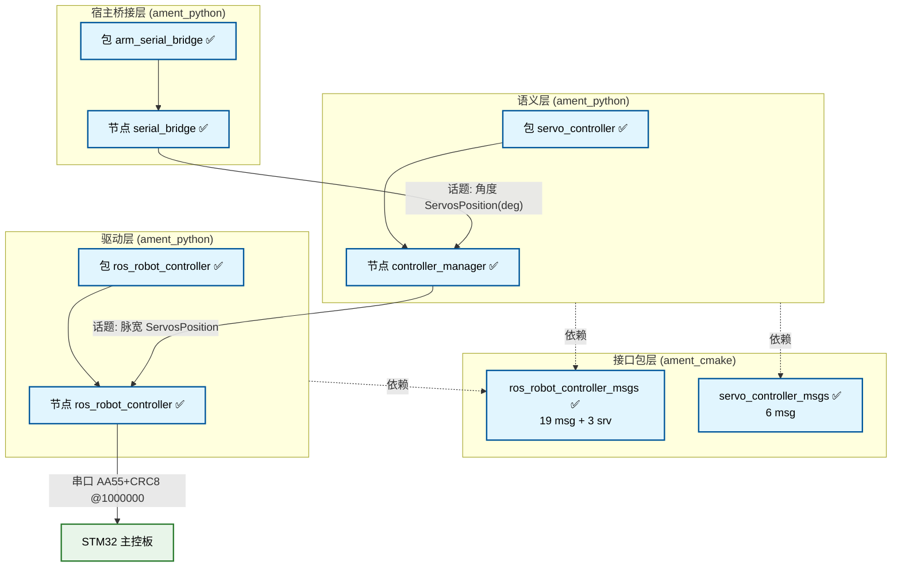
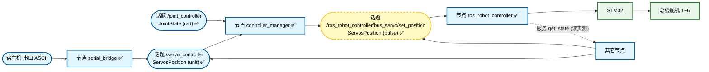
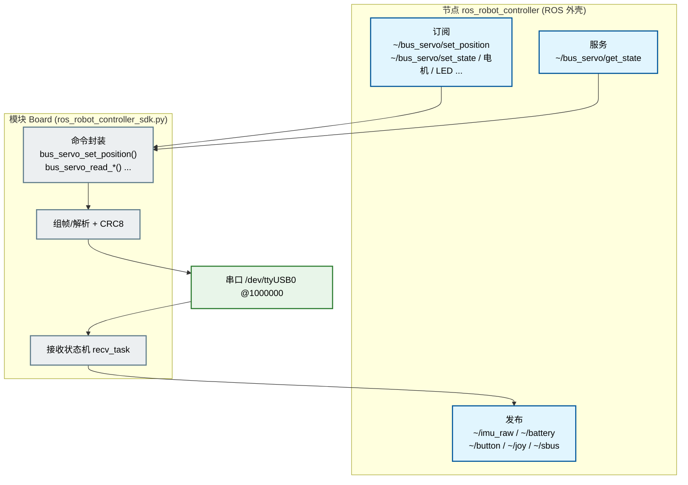
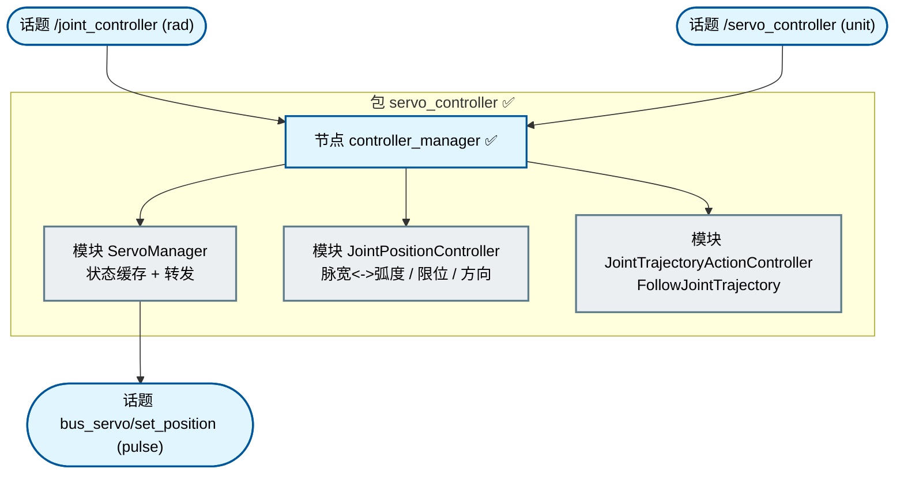

# 代码组织结构（包 / 节点 / 数据管线）

> 索引：[`pi_project_mem.md`](pi_project_mem.md)（项目枢纽）
> 目的：用"包 → 节点 → 模块"的层次讲清代码组织，并用 mermaid 同时表达
> **归属关系 / 依赖关系 / 数据管线**；复杂子系统单独分解（类似 Simulink 子系统）。

- 当前进度：阶段 1–4 已完成（接口 + 驱动 + 语义层，硬件已验证）。
- 图例：🟦 节点　🟨 话题/服务　🟩 硬件　🟪 待移植

---

## 1. 一句话结构

```
接口包 (msgs)  ←依赖←  语义层包 (servo_controller)  ──话题──▶  驱动层包 (ros_robot_controller)  ──串口──▶  STM32
```

---

## 2. 图 A：总览（包 / 节点 / 依赖）



---

## 3. 图 B：数据管线（话题 / 服务）

> 下行 = 指令；上行 = 反馈。🟪 为规划中（阶段 4），🟦 为已完成。



> 注：阶段 4 之前，只有"脉宽"这一层可用（`EXT --> T2 --> N2 --> HW` 这条链已实测可用）。

---

## 4. 图 C：驱动子系统内部（Simulink 风格分解）



**归属关系**：`包 ros_robot_controller` → `节点 ros_robot_controller` + `模块 Board`。
**关键**：`Board` 是唯一直接接触串口的模块。

---

## 5. 图 D：语义子系统



---

## 6. 包清单

| 包 | 构建类型 | 功能 | 状态 |
| --- | --- | --- | --- |
| `ros_robot_controller_msgs` | ament_cmake | 驱动层与语义层之间的接口（19 msg + 3 srv） | ✅ 已移植 |
| `ros_robot_controller` | ament_python | 驱动节点 + `Board` SDK（唯一持有串口） | ✅ 已移植、硬件已验证 |
| `servo_controller_msgs` | ament_cmake | 语义层对外接口（6 msg，含 `ServosPosition`/`ServoStateList`/`Grasp`） | ✅ 已移植 |
| `servo_controller` | ament_python | 语义网关（关节/脉宽换算、限位、轨迹 action） | ✅ 已移植、硬件已验证 |
| `arm_serial_bridge` | ament_python | 宿主串口 ASCII 桥（命令 → `/servo_controller` deg） | ✅ 已实现、硬件联调通过 |
| `test_01_CH340` | ament_cmake | 早期 C++ 串口测试（115200/ASCII，非机械臂协议） | 保留、弃用 |

**依赖关系**：
`servo_controller` → { `servo_controller_msgs`, `ros_robot_controller_msgs`, `control_msgs`, `sensor_msgs`, `std_srvs`, `rclpy` }
`ros_robot_controller` → { `ros_robot_controller_msgs`, `rclpy`, `pyserial`, `std_msgs`, `std_srvs`, `sensor_msgs` }
`arm_serial_bridge` → { `servo_controller_msgs`, `sensor_msgs`, `rclpy`, `pyserial` }

---

## 7. 节点清单

| 节点 | 包 | 可执行名 | 功能 | 状态 |
| --- | --- | --- | --- | --- |
| `ros_robot_controller` | `ros_robot_controller` | `ros_robot_controller` | 串口驱动；话题/服务 ↔ `Board`；发布上行传感器 | ✅ |
| `controller_manager` | `servo_controller` | `servo_controller` | 语义网关；`/servo_controller`、`/joint_controller` → 脉宽；发布 `servo_states`/`joint_states`；轨迹 action | ✅ 硬件已验证 |
| `grasp` | `servo_controller` | `grasp` | 抓取/放置高层（依赖未移植的 `kinematics`） | 已移植（暂不启动） |
| `serial_bridge` | `arm_serial_bridge` | `serial_bridge` | 宿主串口 ASCII → `/servo_controller`（deg）；缓存 `/controller_manager/joint_states` 供 `Q` 回读 | ✅ 硬件联调通过 |
| `serial_send_node` | `test_01_CH340` | `serial_send_node` | 早期串口测试 | 弃用 |

---

## 8. 目录树（当前 `src/`）

```
src/
├── test_01_CH340/                # 早期 C++ 串口测试（弃用）
│   ├── src/serial_send_node.cpp
│   ├── CMakeLists.txt
│   └── package.xml
├── ros_robot_controller_msgs/    # ✅ 接口包
│   ├── msg/ (19)
│   ├── srv/ (3)
│   ├── CMakeLists.txt
│   └── package.xml
├── ros_robot_controller/         # ✅ 驱动包
│   ├── ros_robot_controller/
│   │   ├── ros_robot_controller_node.py   # ROS 外壳（节点）
│   │   └── ros_robot_controller_sdk.py    # Board 模块（串口+协议）
│   ├── launch/ros_robot_controller.launch.py
│   ├── scripts/                  # udev 规则
│   ├── setup.py
│   └── package.xml
├── servo_controller_msgs/        # ✅ 接口包
│   ├── msg/ (6)
│   ├── CMakeLists.txt
│   └── package.xml
├── servo_controller/             # ✅ 语义网关包
│   ├── servo_controller/         # controller_manager / ServoManager / JointPositionController / ...
│   ├── config/servo_controller.yaml
│   ├── launch/servo_controller.launch.py
│   ├── setup.py
│   └── package.xml
└── arm_serial_bridge/            # ✅ 宿主桥接包
    ├── arm_serial_bridge/        # protocol.py（纯解析）/ serial_bridge.py（ROS 节点）
    ├── scripts/host_arm.py       # 宿主机工具
    ├── launch/arm_serial_control.launch.py
    ├── test/test_protocol.py
    ├── setup.py
    └── package.xml
```

---

## 9. 变更记录

| 日期 | 内容 |
| --- | --- |
| 2026-09-11 | 建立：包/节点/依赖/数据管线四类视图 + 子系统分解。 |
| 2026-09-11 | 阶段 3、4 完成，更新状态为 ✅（含硬件联调）。 |
| 2026-09-11 | 新增 `arm_serial_bridge` 宿主串口桥（图 A/B、包/节点清单、目录树已更新）。 |
