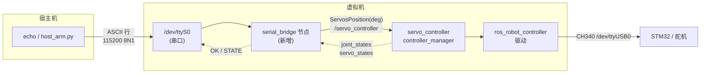
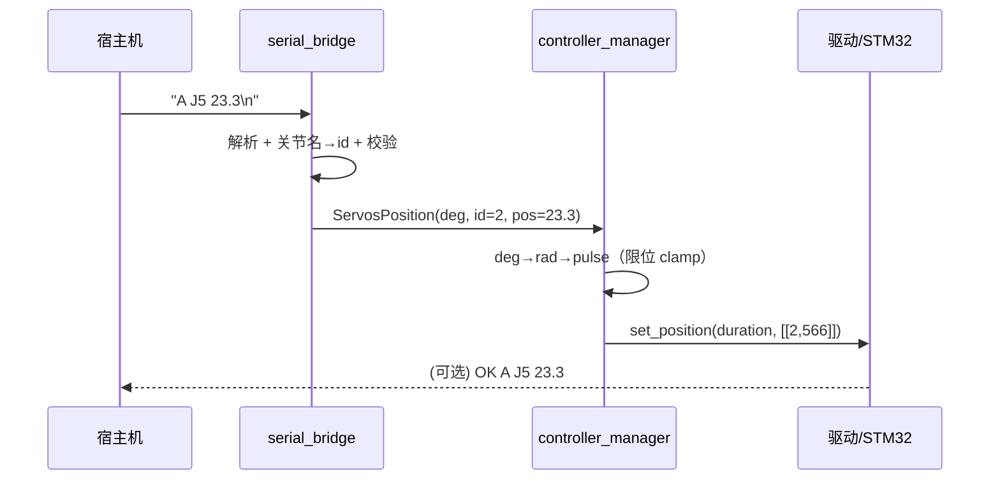

# 宿主机串口控制机械臂方案

> 回链：[`pi_project_mem.md`](pi_project_mem.md) ｜ 关联：[`arm_control_ros2_design.md`](arm_control_ros2_design.md)、[`arm_control_port_plan.md`](arm_control_port_plan.md)
> 状态：**✅ 已实现并硬件联调通过**

---

## 1. 目标

- 宿主机通过一条**虚拟串口**向 VM 发送**简单 ASCII 命令**，控制机械臂关节角度。
- VM 侧**复用现有语义网关**，不新增控制逻辑：命令 → `ServosPosition(unit=deg)` → `/servo_controller`。
- 可选：回读关节角度（`Q`）。

**非目标**：笛卡尔/IK（本机不可用）、轨迹规划。

---

## 2. 拓扑



**关键点**：宿主机 ↔ VM 是**第二条串口**（虚拟），与机械臂的 CH340 互不干扰。

---

## 3. 协议（ASCII 行，`\n` 或 `\r` 结尾，两者都兼容）

### 命令

| 命令 | 含义 | 示例 |
| --- | --- | --- |
| `PING` | 心跳 | `PING` |
| `Q` | 查询全部关节角度 | `Q` |
| `H` | 回初始姿态 | `H` |
| `A <j> <deg>` | 设单关节角度（可多组） | `A J5 23.3`、`A J1 10 J2 -20` |
| `A <j> <deg> T <ms>` | 指定时长 | `A J5 23.3 T 800` |

- 关节名：`J1`…`J5` + `G`（夹爪，即 `r_joint`），大小写不敏感；亦接受 `1`…`5`。
- 角度单位：**deg**（弧度/脉宽由网关换算）。
- 非法命令/越界 → `ERR ...`，不动作。

### 响应

| 响应 | 含义 |
| --- | --- |
| `PONG` | 心跳应答 |
| `OK A J5 23.3` | 已下发 |
| `STATE J1=.. J2=.. …` | 当前角度（来自 `joint_states`） |
| `ERR unknown_joint J9` / `ERR bad_arg` | 错误 |

---

## 4. 组件

| 组件 | 位置 | 职责 | 输入 → 输出 |
| --- | --- | --- | --- |
| `host_arm.py` | 宿主机 | 命令行 → 协议行 | argv → 串口字节 |
| `serial_bridge` | VM（ROS2 节点） | 解析/校验 → 发布 | 串口行 → `ServosPosition` |
| `servo_controller` | VM | 单位换算 + 限位 | `ServosPosition` → 脉宽 |
| `ros_robot_controller` | VM | 串口协议 | 脉宽 → STM32 |

**serial_bridge 参数（ROS 参数）**

| 参数 | 默认 | 说明 |
| --- | --- | --- |
| `device` | `/dev/ttyS0` | 与宿主机相连的串口 |
| `baudrate` | `115200` | 波特率 |
| `default_duration` | `0.5` | 未指定 `T` 时的时长 (s) |
| `joint_topic` | `/servo_controller` | 输出话题 |

---

## 5. 关节映射（来自 `config/servo_controller.yaml`）

| 命令名 | 关节 | 舵机 id | 备注 |
| --- | --- | --- | --- |
| `J1` | joint1 | 6 | |
| `J2` | joint2 | 5 | |
| `J3` | joint3 | 4 | 方向相反（config min>max） |
| `J4` | joint4 | 3 | |
| `J5` | joint5 | 2 | |
| `G` | r_joint | 1 | 夹爪 |

> 限位由网关 `JointPositionController.pos_rad_to_pulse()` 自动 clamp，bridge 无需重复实现。

---

## 6. 部署：加一个 VMware 虚拟串口

**VM 设置 → Serial Port → 勾选 Enable，连接方式三选一：**

| 方式 | 宿主机侧怎么发命令 | 适用 |
| --- | --- | --- |
| **命名管道**（推荐） | Linux：写 FIFO；Windows：写 `\\.\pipe\<name>` | 跨平台、最像串口 |
| **套接字** | `nc <host> <port>` 或 Python socket | 最简单、易调试 |
| 物理串口 | 直连真实 COM/tty | 需真实口 |

- VM 内设备名通常为 **`/dev/ttyS0`**（第二口 `ttyS1`…）；**本机宿主口用的是第二个 USB-TTL（CH340），按插入顺序为 `/dev/ttyUSB1`**。
- 虚拟串口两端波特率**随意但需一致**（建议 `115200 8N1`）。
- 权限：把用户加入 `dialout`（若需要）。

---

## 7. 时序（一次角度下发）



---

## 8. 实现（已完成）

包：`src/arm_serial_bridge`（官方 `ros2 pkg create`，ament_python）。

| 文件 | 职责 |
| --- | --- |
| `arm_serial_bridge/protocol.py` | **纯协议解析/格式化**（无 ROS/无串口，可单测） |
| `arm_serial_bridge/serial_bridge.py` | ROS 节点：串口行 → `ServosPosition` |
| `scripts/host_arm.py` | 宿主机工具（仅需 `pyserial`） |
| `launch/arm_serial_control.launch.py` | 驱动 + 网关 + bridge 一条命令起 |
| `test/test_protocol.py` | 协议单测 |

启动（一条命令，按插入顺序即可，无需 udev）：
```bash
# 机械臂先插 -> ttyUSB0；宿主口后插 -> ttyUSB1（即默认值）
ros2 launch arm_serial_bridge arm_serial_control.launch.py

# 需要时可覆盖
ros2 launch arm_serial_bridge arm_serial_control.launch.py \
  arm_device:=/dev/ttyUSB0 host_device:=/dev/ttyUSB1
```

宿主机发命令（`serial_bridge` 参数 `device`/`baudrate`/`default_duration`）：
```bash
python3 scripts/host_arm.py --device /dev/ttyS0 A J5 23.3   # Linux
python3 scripts/host_arm.py --device COM5 A J5 23.3        # Windows
```

### 验证结果

- `colcon test`：**24 tests, 0 failures**（flake8 / pep257 / copyright / protocol 单测全绿）。
- pty 模拟宿主机口：`PING→PONG`、`A J5 23.3→OK` 且 `/servo_controller` 收到 `('deg', [(2, 23.3)])`、`A J9 1→ERR unknown_joint J9`。
- **完整硬件链路**（pty + 真实 STM32）：`A J5 16.3` → `Q` 回读 `STATE ... J5=16.1 ...` → `A J5 23.3` 回位。

---

## 9. 测试用例

| 用例 | 期望 |
| --- | --- |
| `PING` | `PONG` |
| `A J5 23.3` | 舵机 2 到位，`OK` |
| `A J1 10 J5 40` | 两关节同时到位 |
| `Q` | 返回 `STATE ...` |
| `A J9 10` | `ERR unknown_joint J9` |
| `A J5 999` | 被限位 clamp（不报错或 `ERR`） |

---

## 10. 风险 / 注意

- **换行**：Linux 发 `\n`；Windows 工具可能发 `\r\n`，解析端需兼容。
- **独占**：串口同一时刻只能一个读端；bridge 未退干净会占口。
- **无校验**：纯 ASCII 无 CRC，适合本地开发；如需可靠可加序号/校验。
- **安全**：建议保留 `H`(回初始) 与限位；必要时加 `STOP`。
- **与 CH340 无关**：此串口是宿主↔VM 虚拟口，不经过 STM32。

---

## 11. 关联文档

- 架构与契约：[`arm_control_ros2_design.md`](arm_control_ros2_design.md)
- 组件与数据流：[`arm_control_components.md`](arm_control_components.md)
- 移植计划/验收：[`arm_control_port_plan.md`](arm_control_port_plan.md)
- 测试脚本：[`test/README.md`](test/README.md)
- 枢纽：[`pi_project_mem.md`](pi_project_mem.md)
