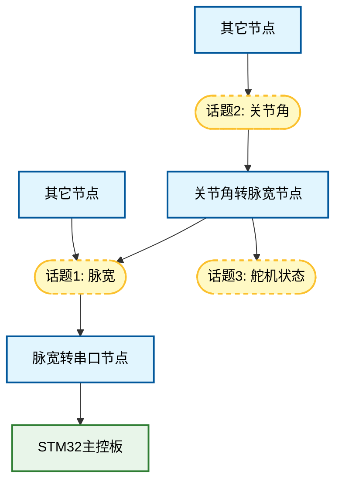

# 草稿_幻尔机械臂控制底层部分设计

> 索引：[`pi_project_mem.md`](pi_project_mem.md)（项目枢纽）

## 要点

- **N1 不直连 N2**：N1 产物是脉宽，因此 N1 **发布到话题1(脉宽)**；N2 只**订阅**话题1。
- **话题2 也对外开放**：其它节点可直接往话题2(关节角)发关节角，与话题1 一样是开放接口。
- **话题1 是统一入口**：N1 与外部节点都是它的生产者（fan-in）。
- **N2 是唯一串口持有者**，向下对接 STM32。
- **话题3 由 N1 发布**（对应厂商 `/controller_manager/servo_states`）：内容是**命令位置（开环）**，非实测。
- 实测读取是 N2 的服务 `get_state`（请求-应答，非话题）；本图保持一致，暂不画入。
