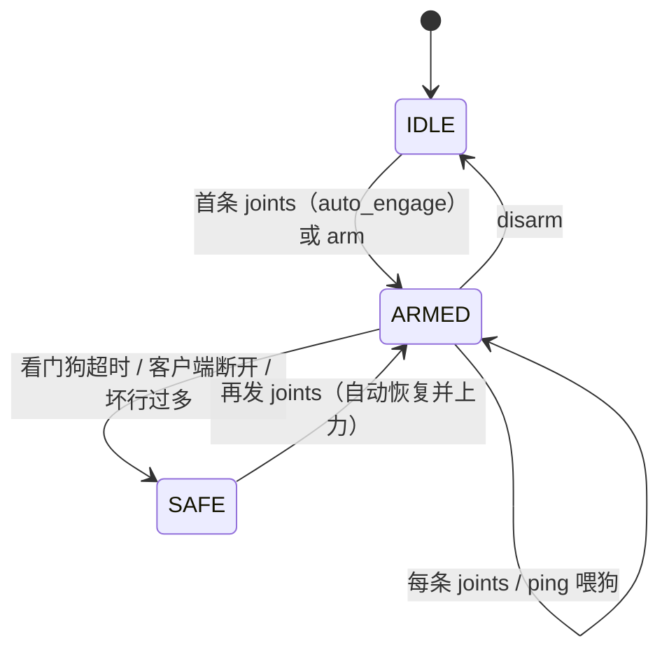

# arm_lerobot_dataset_stream

**宿主机（Windows / 无 ROS2）与 VM 之间的机械臂数据流 + 控制链路**，一条 TCP 连接双向：

- **上行**：VM 读 6 个舵机的**实测**角度 → 换行 JSON 广播给宿主机（用于 LeRobot 录制）
- **下行**：宿主机下发关节目标 → VM 转发给舵机（用于 `lerobot-replay` / rollout）

```
宿主机 (Windows, 只用 socket)                    VM (ROS2)
        │                                            │
        │◀──── {"t","seq","names","q","pulse"} ──────│  dataset_stream
        │        （每帧换行 JSON，实测角）            │   ↑ get_state
        │                                            │  驱动 ── 舵机
        │──────  {"cmd":"joints","names","q"} ──────▶│   ↓ /servo_controller
        │        （下行，默认关闭）                    │
```

---

## 1. 快速开始

```bash
# 清残留（养成习惯；换端口/改参数后重启用）
./My_note/dev/test/cleanup_arm_stack.sh

# A) 录制（下行关闭 = 零干扰；再卸力方便手拖）
ros2 launch arm_lerobot_dataset_stream arm_lerobot_dataset.launch.py release_torque:=true poll_rate_hz:=25.0

# B) 回放 / rollout（下行开启）
ros2 launch arm_lerobot_dataset_stream arm_lerobot_dataset.launch.py enable_downlink:=true poll_rate_hz:=25.0
```

宿主机连 **`192.168.174.128:1348`**（仅主机网：VM `192.168.174.128` ↔ 宿主机 `192.168.174.1`）。

> `release_torque:=true` 是**启动就卸力**（手拖示教用）；只在下行关闭时用，
> 回放时不要加（否则宿主机第一条命令还得先上力）。

启动日志里确认这 3 行再让宿主机连：

```
[ros_robot_controller-1] ... start                          ← 串口 OK（打不开会自动重试 30×1s）
[dataset_stream-3] driver ready (get_state available)       ← 驱动可达
[dataset_stream-3] DOWNLINK ENABLED: host servo commands WILL be executed
```

> `ros2 launch` 会起 3 个节点：驱动 + 语义网关 + `dataset_stream`。只想跑流：
> `ros2 run arm_lerobot_dataset_stream dataset_stream --ros-args -p ...`

---

## 2. TCP 协议

- **VM 是服务端**，`tcp_host:tcp_port`（默认 `0.0.0.0:1348`），宿主机连上来即可
- **多客户端**广播；一个连接同时承载上行+下行
- **上行是"最新帧"模型**：采样 tick 只覆盖写一个变量，每个客户端有独立发送线程取最新值 →
  **慢客户端拖不住采样**，宿主机 `dataset.fps` 可以任意改（读侧 drain 到最新即可，延迟 ≤1 帧）

### 上行（VM → 宿主机）：每行一个 JSON

```json
{"t":1789287268.123,"seq":42,
 "names":["joint1","joint2","joint3","joint4","joint5","r_joint"],
 "q":[0.21,-0.13,0.0,0.0,0.28,0.0],
 "pulse":[566,500,500,500,520,700]}
```

| 字段 | 含义 |
|---|---|
| `t` | Unix 时间戳（秒） |
| `seq` | 帧序号，**用它查丢帧** |
| `names` | **权威关节顺序**（逻辑序，按名字排） |
| `q` | 关节角 **弧度**（实测；不做裁剪） |
| `pulse` | 舵机原始脉宽 0~1000（调试用） |

换算：`1000 pulse = 240°`，即 `0.24°/pulse`。

### 下行（宿主机 → VM）：每行一个 JSON，`cmd` 五选一

| `cmd` | 载荷 | 作用 |
|---|---|---|
| `joints` | `names` + `q`（弧度） | **唯一会动臂的命令**。首条会自动上力（`auto_engage`） |
| `arm` | — | 上力并进入 ARMED |
| `disarm` | — | 卸力并清空目标 |
| `stop` | `release`(bool) | 停止执行，可选卸力 |
| `ping` | — | 只喂看门狗（保持 ARMED） |

```json
{"cmd":"joints","names":["joint1","joint2","joint3","joint4","joint5","r_joint"],
 "q":[0.21,-0.13,0.0,0.0,0.28,0.0],"seq":1,"t":1789287268.1}
```

- 未知关节名 / 非数值 / NaN / Inf 会被**跳过**，不会丢整条命令
- 可选防误触：`downlink_token`（设了则要求命令带 `token` 字段）
- 坏行太多（默认 >50，`max_parse_errors`）→ 进 SAFE

---

## 2.5 ROS 接口（本节点用到的）

| 方向 | 名字 | 类型 | 说明 |
|---|---|---|---|
| pub | `/dataset_stream/joint_states_measured` | `sensor_msgs/JointState` | 实测角（本地调试用，等价于上行 TCP 的 `q`） |
| pub | `/servo_controller` | `ServosPosition` | **下行实际发这个**；`position_unit='rad'`，`duration=1/poll_rate_hz` |
| pub | `/ros_robot_controller/bus_servo/set_state` | `SetBusServoState` | 上力/卸力 |
| client | `/ros_robot_controller/bus_servo/get_state` | `GetBusServoState` | 读实测位置（`get_position=1`，id 取 6 个关节） |
| client | `/ros_robot_controller/init_finish` | `Trigger` | 启动卸力前等驱动就绪 |

---

## 3. 参数

launch 暴露（`ros2 launch ... <参数>:=<值>`）：

| 参数 | 默认 | 说明 |
|---|---|---|
| `arm_device` | `/dev/ttyUSB0` | 机械臂串口（多个 CH340 时**先插机械臂**） |
| `arm_baudrate` | `1000000` | 波特率 |
| `tcp_port` | `1348` | TCP 端口 |
| `poll_rate_hz` | `30.0` | 采样频率；**建议 20~25**（6 舵机一轮读 ≈35ms，30 会顶满总线） |
| `release_torque` | `false` | 启动即卸力（手拖示教用，配合 `enable_downlink:=false`） |
| `enable_downlink` | `false` | **执行宿主机命令**；`false` = 纯录制，零干扰 |
| `watchdog_timeout` | `1.0` | 多少秒没收到命令 → SAFE（拉长就调它） |
| `release_on_timeout` | `true` | 看门狗触发时是否卸力 |
| `release_on_disconnect` | `true` | 客户端断开时是否卸力 |

未暴露的（用 `ros2 run` 或运行时改）：

| 参数 | 默认 | 说明 |
|---|---|---|
| `tcp_host` | `0.0.0.0` | 监听地址 |
| `auto_engage` | `true` | 首条 `joints` 自动上力 |
| `downlink_token` | `''` | 非空则校验命令里的 `token` |
| `max_parse_errors` | `50` | 连续坏行上限 |
| `servo_config` | 自动 | 指向 `servo_controller.yaml`（关节 id / 软限） |

```bash
# 运行时改（临时）
ros2 param set /dataset_stream watchdog_timeout 3.0
```

---

## 4. 安全状态机



- `enable_downlink=false` 时 reader **只丢弃不执行**，状态机不动
- 节点退出时若处于 ARMED 会先松力
- 上力命令连发两次（防单帧丢失导致全程无力）

---

## 5. 日志判读

| 日志 | 含义 |
|---|---|
| `downlink: 64 cmds in 5.0s (12.7 Hz) state=ARMED` | 每 5 秒统计：收到/执行了多少条命令、平均频率、**安全状态** |
| `state=ARMED` | ✅ 正常执行中（上力） |
| `state=SAFE` + `downlink SAFE: <原因>` | ⚠️ 停了。原因=`watchdog timeout` / `client disconnected` / `too many malformed downlink lines` |
| `bus_servo_read_position: [407]` | 驱动读某个舵机的当前脉宽（正常噪音） |
| `bus_servo read timeout: id=N cmd=0xNN` | 某次读没等到回包（0.3s 后放弃返回 `None`，**会自动恢复**） |
| `no measured frames for Ns while M client(s) connected: <原因>` | 上行推不出帧了，见下方排查 |
| `client connected: <ip:port>` / `client disconnected: <ip:port>` | 宿主机连上/断开 |

---

## 6. 排障

| 现象 | 原因 / 处理 |
|---|---|
| `cannot bind 0.0.0.0:1348 ... another dataset_stream is probably still running` | 端口被残留进程占着 → `./My_note/dev/test/cleanup_arm_stack.sh` |
| 启动即 `SerialException: [Errno 5] could not open port` | CH340 掉线 → 驱动**自动重试 30×1s**，等几秒；不行就拔插 USB / VMware 重新连接 |
| `driver NOT ready: .../get_state is missing` | 驱动节点死了（多半是上面的串口问题） |
| `no measured frames for Ns` | ① CH340 掉线 ② 舵机**电源没开**（每次读 0.3s 超时后放弃 → 一直没帧，但不会卡死）③ 多个 `ros_robot_controller` 抢串口 |
| 回放动作卡住 / 只做一部分 | 见 `My_note/dev/stream_docs/VM侧排查_回放不稳定.md`（已定位并修复） |
| 手臂一开动就抖一下 | 起手大跳 → 电流尖峰导致串口丢一次响应（现在是 0.3s 抖动，不再卡死）；根治靠给舵机独立电源 |
| 命令率忽高忽低 | `poll_rate_hz` 偏高：6 舵机一轮读 ≈35ms，30Hz 顶满总线 → 降到 20~25 |

**注意**：别在命令行直接 `pkill -f dataset_stream` —— 发起命令的 shell 自身 cmdline 也含该字符串，**会把自己杀掉**。用上面的清理脚本。

---

## 7. 文件

| 文件 | 内容 |
|---|---|
| `dataset_stream.py` | 节点：采样 → 推流；下行 reader / 控制 tick / 安全状态机 |
| `downlink.py` | **纯逻辑**（无 ROS/socket）：`COMMANDS` / `parse_line` / `extract_targets` / `SafetyState` |
| `launch/arm_lerobot_dataset.launch.py` | 驱动 + 网关 + 流 三节点一键启动 |
| `test/test_downlink.py` | `downlink.py` 单测 |
| `My_note/dev/test/test_downlink_integration.py` | 下行集成测试（假驱动，无需真机） |
| `My_note/dev/test/probe_replay_follow.py` | 真机验证：下发小目标，看实测角是否跟随 |
| `My_note/dev/test/cleanup_arm_stack.sh` | 清残留进程 / 释放 1348 端口 |
| `My_note/dev/test/monitor_servo_cmds.py` | 带时间戳监控所有舵机指令 |
| `My_note/dev/test/probe_joint_range.py` | 卸力手推，测各关节可达 pulse 范围 + 读硬限 |
| `My_note/dev/test/read_servo_id.py` / `read_servo_state.py` | 直连 SDK 读 id / 位置·电压·温度 |

---

## 8. 相关文档

| 文档 | 内容 |
|---|---|
| `My_note/dev/lerobot数据集流协议.md` | 协议全文（含上行异步模型） |
| `My_note/dev/stream_docs/lerobot下行控制协议与VM设计.md` | 下行设计 |
| `My_note/dev/stream_docs/VM侧完成报告_下行回放.md` | 给宿主机侧的完成报告 |
| `My_note/dev/stream_docs/VM侧排查_回放不稳定.md` | 卡死根因与修复（含实验数据） |
| `My_note/dev/test/README.md` | 测试脚本清单 |
| `My_note/README.md` | 本机用途总览 |

---

## 9. 已知边界

- **关节软限**以 `src/servo_controller/config/servo_controller.yaml` 为唯一准（已对齐舵机硬限）：

  | 关节 | 舵机 id | 脉冲范围 | 备注 |
  |---|---|---|---|
  | joint1 | 6 | 0 ~ 1000 | |
  | joint2 | 5 | 125 ~ 875 | 对齐硬限 |
  | joint3 | 4 | 1000 ~ 0 | **反向**（min>max） |
  | joint4 | 3 | 84 ~ 875 | 软限 −100°~+90° |
  | joint5 | 2 | 0 ~ 1000 | |
  | r_joint | 1 | 0 ~ 700 | 夹爪，init=700 |

- 改 yaml 后需 `colcon build` 同步 install（厂商 SDK 不读 yaml）
- **`/joint_controller`（`sensor_msgs/JointState`）厂商回调有 bug，勿用**
- 下发的 `duration = 1/poll_rate_hz`，舵机按它自己插值；节点侧**不做限速**
